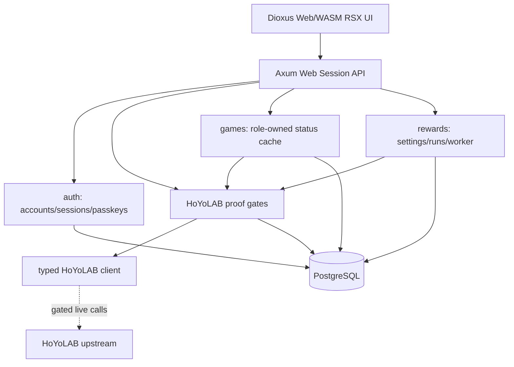
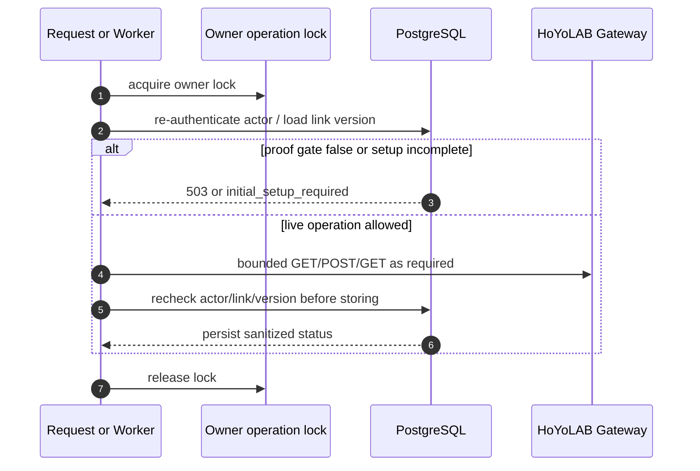
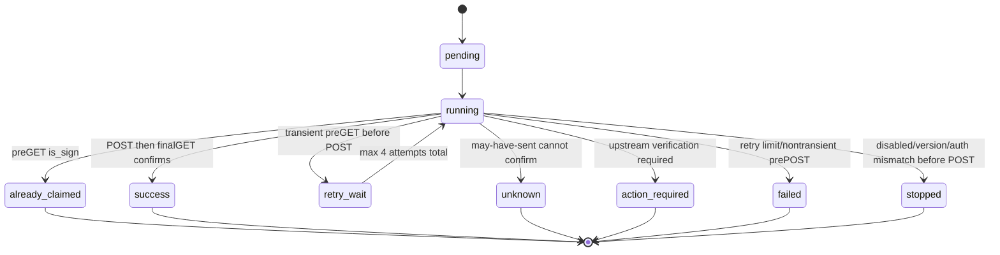

# AttOsGameDashboard 実装設計案

## 1. 構成

現在のDashboardは単一Rustプロセスで、Axum HTTP、Tokio runtime、SeaORM + PostgreSQL、Argon2id、WebAuthn、Dioxus 0.7.10 Web/WASM RSX UIを使う。UIはstandalone workspace crate `dashboard-ui` / package `attos-dashboard-ui` で構築し、`dx build --package attos-dashboard-ui --platform web --release` のpublic出力を `DASHBOARD_UI_DIR` から配信する。公式Dioxus Components由来のButton/Card/Card partsをDioxusLabs/components `9a758255ea26e2b20c8cecf4c1c946feb9e71da7`（MIT）からsource templateとして同梱し、`dioxus-primitives` も同じimmutable SHAにpinする。SSR/fullstack server、native app、CDN、危険なHTML injectionや`document::eval`は使わない。

責務:

- `dashboard-ui/src/`: Dioxus RSX app/pages、typed browser API models、web-sys/js-sys WebAuthn bridge。localStorage secrets、manual Cookie/Origin header、SSR/fullstack serverは持たない。
- `dashboard-ui/src/components/`: official Dioxus Components由来Button/Card/Card partsとMIT/provenance。
- `src/dashboard/http/`: route composition、DTO、Origin/session boundary、safe error mapping、compiled Dioxus UI、`/docs` index、`/openapi.json`。
- `src/dashboard/auth/`: user lifecycle、password/session、passkey registration/authentication、deletion request。
- `src/dashboard/hoyolab/`: Cookie parse/seal、owner operation lock、proof-gated verification/sync。
- `src/dashboard/games/`: owned game UID list、visibility、curated status cache。
- `src/dashboard/rewards/`: settings、runs、attempts、guard、worker、fixed-offset schedule。
- `src/hoyolab/client/`: typed upstream protocol client。Dashboard policyをここへ混ぜない。

APIとschedulerは同じDB/業務処理を使う。単一process/instance前提で、Redisや分散queueはない。更新時down timeは許容する。

## 2. HTTP境界

- Protected routeはsession cookieをDB上のhashへ照合する。HTTPS時のcookie名は `__Host-attos_session`、localhost非secure時は `attos_session`。
- Safe method以外は `Origin` headerが `PUBLIC_ORIGIN` と完全一致する必要がある。
- Responseには `Cache-Control: no-store` と `X-Content-Type-Options: nosniff` を付与する。Dioxus HTML shellにはCSPも付与する。DX 0.7.10のexternal module loaderを許可し、`script-src 'self' 'wasm-unsafe-eval'`、`style-src 'self'`、`connect-src 'self'`、`object-src 'none'`、`frame-ancestors 'none'`、`base-uri 'none'` を使う。`'unsafe-inline'` と一般の `'unsafe-eval'` は使わない。release bundleのCSP・WASM動作はChromiumと合成fixtureで検証済み。
- Body limitは16KiB。JSON DTOは `serde(deny_unknown_fields)` を使う。
- Error DTOは `{ "error": code, "message": sanitized }`。上流message、driver source、秘密値は返さない。

## 3. データモデルと保持

| Entity | 役割 |
|---|---|
| `users` | username, admin flag, active, must_change_password, password hash |
| `sessions` | token hash primary key, fixed expiry |
| `passkeys` | WebAuthn credential JSON, credential id, label |
| `audit` | lifecycle audit; secret/game dataは含めない |
| `hoyolab_accounts` | owner 1:1、nullable verified UID unique、encrypted credentials、credential_version、auth_status |
| `game_accounts` | link配下のgame_kind/game_uid/region、visible、detected、last_detected_at |
| `game_status_cache` | UIDごとのlatest curated payload version 1、fetched/error timestamps |
| `reward_settings` | link × game、enabled、local_time、auth_status、next_run_at |
| `reward_runs` / `reward_attempts` | durable reward execution and attempts, 5-day history |
| `reward_guard` | POST may-have-sent durable guard |
| `deletion_requests` | inactive target deletion completion queue |

CookieはAES-256-GCMで保存し、AADに用途/version/owner/verified UID有無と値を含める。keyはDB外の `HOYOLAB_COOKIE_KEY`。key rotation/re-encryption toolingは未実装。

## 4. HoYoLAB proof gate

`CookieStore` には二つの本番gateがある。

| Gate | 現在 | 理由 |
|---|---|---|
| owner binding | hardcoded false | account/community identity候補がtoken-to-UID bindingとroles principal一致の本番証拠ではない |
| reward contract | hardcoded false | 実POSTの期間・確認・再送安全性が未承認 |

実装済みの確認処理は、v2 ltoken credential、fresh account identity、fresh community identity、Cookie claimed UID一致、既存UID一致、roles validation、credential version再確認、same-UID update preservationを要求する。これらはmockで検証済みだが、本番gate解除の証拠ではない。

## 5. Owner operation ordering

Lockはowner単位で、別ユーザーはglobal serializeしない。DB table lockはbootstrap empty-table check以外に長時間使わず、admin lifecycleはPostgreSQL advisory transaction lockで短く保護する。パスワードCPU処理はSQL transaction外で行う。

## 6. Game status cache

- `Games::status` は ready verified link と owned game account を要求する。
- hidden/undetectedならfetchせずcache projectionを返す。
- fresh cache条件は payload version 1、payloadあり、`0 <= now - fetched_at <= 5min`。
- upstream successではcurated summaryだけを保存する。failureでは旧payload/fetched_atを保持し、error_code/error_atを更新する。
- retcode 10102相当は該当game reward settingを `action_required` にし、cookie invalid classはlinkを `cookie_invalid` にする。

## 7. Reward worker

Worker tick is independent of page views. It first cleans completed 5-day history while preserving interrupted active work for confirmation, enqueues due enabled ready settings, then processes pending/running/retry_wait runs up to a small batch. `mark_may_have_sent` persists the guard before POST. Unknown/may-have-sent paths never unconditional POST retry; they use GET-only confirmation and otherwise remain unknown. In production the worker exits early because verification and reward gates are false.

## 8. Deletion workflow

Deletion request verifies actor password, reauthenticates current session, locks actor/target consistently, rejects last active admin, marks target inactive, revokes sessions/passkeys, persists `deletion_request`, and records audit. Background completion waits for owner operations, confirms may-have-sent reward runs by bounded GET-only logic, then deletes target-owned data and user row. Target audit rows are removed; other rows where target was actor may be preserved with actor set null.

## 9. API contract

Manual OpenAPI 3.1 is maintained at [`../dashboard-api.json`](../dashboard-api.json). It documents Dashboard routes: auth, passkeys, admin/me, HoYoLAB status/cookie/verify/sync, game accounts/status, reward settings/runs, health, Dioxus UI index, read-only `/docs`, and `/openapi.json`. The compiled `/assets/{...}` subtree is served from `DASHBOARD_UI_DIR/assets` for browser-internal hashed assets only and is not an OpenAPI operation.
