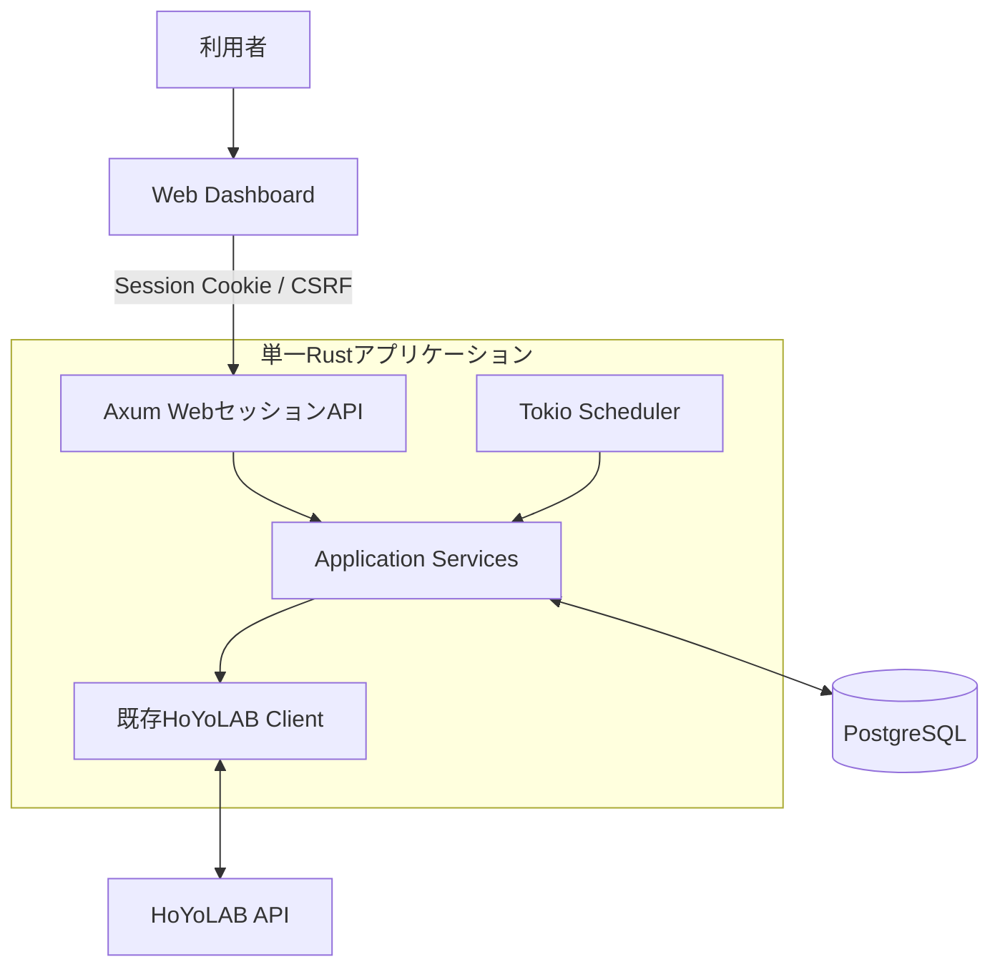
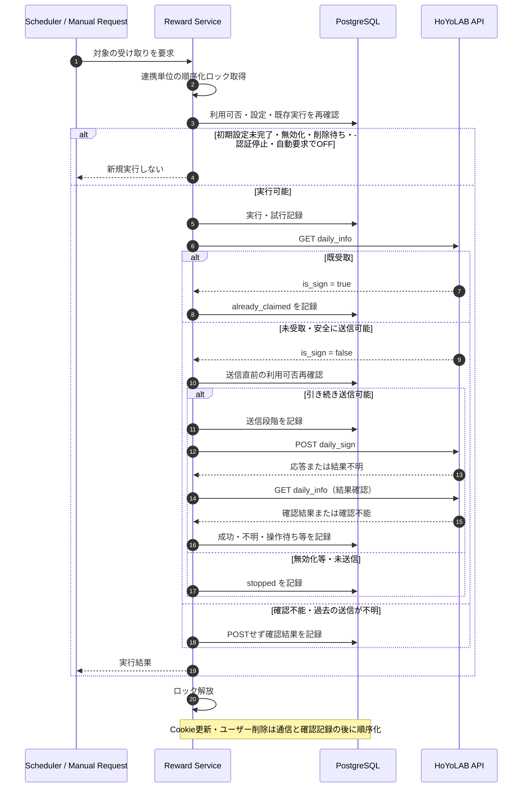
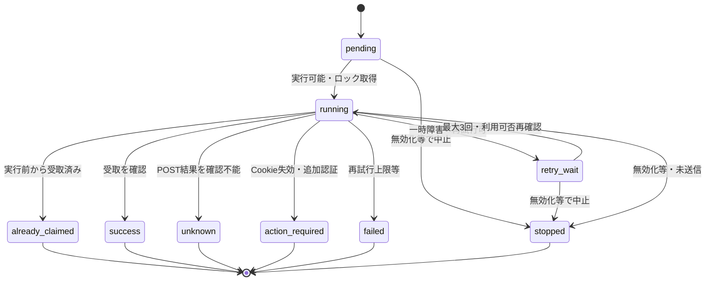
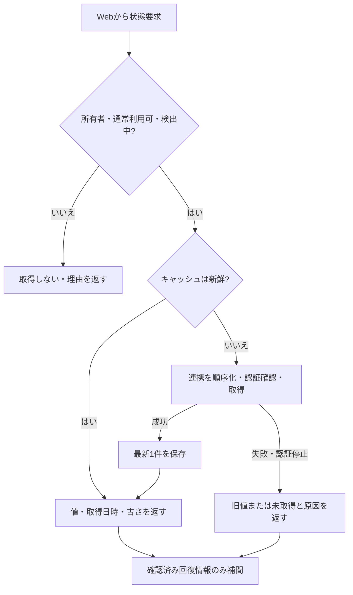

# AttOsGameDashboard 実装設計案

[機能仕様](../spec/AttOsGameDashboard.md)を実現する技術構成・概念モデル・処理方式を記す。合意済みの実装方針と未確定の契約を区別する。基盤・認証のバックエンドは実装済み。Cookie正規化・未検証の暗号化保存を実装したが、**本人UID検証・初期設定完了／通常利用ゲート・Dashboardユーザー削除・HoYoLAB連携の実通信・受け取り・GUIは未実装**であり、以下の全体モデルは完成したスキーマ・APIではない。現コードとの対応と検証範囲は[作業計画](../plans/AttOsGameDashboard.md)で管理する。

## 1. 技術構成

Rust / Axum / Tokio / SeaORM + PostgreSQL / Argon2id / WebAuthn / OpenAPIを使用し、GUIはDioxus Webを想定する。DBはPostgreSQL、アクセスはSeaORM、スキーマ変更は`sea-orm-migration`で管理する。

- Web APIとスケジューラーは同じ業務処理を利用する。UIは業務処理から分離する。
- 実装済み認証は`src/dashboard/auth/`へ集約。Accountsはライフサイクルと利用可否、Sessionsは期限・発行・失効、PasswordはArgon2idを担当する。`auth/passkeys/`は登録・認証・challenge状態・資格情報codecで分割し、既存のuserロック／transaction境界を維持する。
- `src/dashboard/http/`は機能別DTO・ハンドラー、共通Origin境界、Cookie、HTTPエラー変換を分担する。`db/entities/`は保存モデル、`db/migrations/`は順序レジストリと個別スキーマ。`cli.rs`はコマンド配線のみを担当し、認可・ライフサイクル規則は業務側で共用する。詳細な[モジュール地図](../../README.md#dashboardのモジュール地図)と`AGENTS.md`の方針に従い、責務分割時にも公開範囲を広げない。
- 外部クライアント・Bearer PAT・Scopeの経路は作らない。将来のスマホアプリに備えるのは分離だけとし、専用API・別認証を先回り実装しない。
- 上流実装は`src/hoyolab/client/mod.rs`へ置き、同じ`client/`にテストを配置する。Cookie保存業務は`src/dashboard/hoyolab/{credentials,store}.rs`へ分離し、`http/hoyolab.rs`はDTOと輸送だけを担当する。既存の型付きHoYoLABクライアントを再利用し、業務エラー分類・確認フローはその上に実装する。
- APIとスケジューラーは単一プロセス・単一稼働。更新時の停止を許容する。Redis・外部／分散ジョブキューは不要。
- HTTPSリバースプロキシ経由で公開する。公開URL、WebAuthn RP ID、DB接続、Cookie暗号鍵、セッション期間をサーバー設定に持つ。
- スケジュールのタイムゾーンはサーバー共通の固定UTCオフセット（初期UTC+09:00）。ユーザー別タイムゾーンやDST規則は持たない。

## 2. データモデル案

### 2.1. エンティティと関係

原則IDはUUID。以下は全体の概念設計であり、認証と未検証Cookie保存のスキーマだけが実装済み。本人検証・ゲームUID・受け取り関連の詳細は未確定。実装済み認証の主な属性は現entityに合わせ、セッションだけは秘密値の`token_hash`を主キーにする。

| エンティティ | 関係 | 主な属性案 |
|---|---|---|
| `users` | ユーザー | `id`, `username`, `is_admin`, 必須`password_hash`, `must_change_password`, `active` |
| `hoyolab_accounts` | ユーザーと1:1（初期設定未完了のみ0件） | `id`, `owner_user_id`, `hoyolab_uid`, `encrypted_credentials`, `credential_version`, `auth_status` |
| `game_accounts` | 連携から複数検出 | `id`, `hoyolab_account_id`, `game_kind`, `game_uid`, `region`, `visible`, `detected`, `last_detected_at` |
| `reward_settings` | HoYoLABアカウント × ゲーム | `id`, `hoyolab_account_id`, `game_kind`, `enabled`, `local_time`, ゲーム別追加認証状態、次回実行情報 |
| `reward_runs` | 設定ごとの実行 | `id`, `setting_id`, 自動／手動／catchupの別, `period_key`, `status`, 実行・完了日時、POST送信状況 |
| `reward_attempts` | 実行ごとの試行 | `id`, `run_id`, 試行番号, `result`, 確認状況、次回試行時刻、日時 |
| `game_status_cache` | UIDごとに最大1件 | `game_account_id`, `fetched_at`, バージョン付きJSONの`payload` |
| `passkeys` | 任意追加のWebAuthn資格情報 | `id`, `user_id`, バイナリ`credential_id`, JSON`credential`, `label`, `created_at` |
| `sessions` | ログインごとに複数発行 | 主キー`token_hash`, `user_id`, 固定`expires_at` |
| `account_audit` | 復旧などのライフサイクル操作 | `id`, 操作者, 対象ユーザー, `action`, `created_at`（秘密値・ゲームデータを含めない） |

`api_tokens`、招待、PW再設定リンクのエンティティは作らない。HoYoLAB秘密情報は`users`に混ぜず、別の保存モデルを維持する。現在は単一credential familyへ正規化したCookieをAES-256-GCMで暗号化し、version byte／12-byte nonce／ciphertext／16-byte tagをバイナリ保存する。AADは用途・version・owner UUID・検証済みUID（未検証はnull）を含む。`HOYOLAB_COOKIE_KEY`は32-byteの秘密鍵でDBと別に保持し、既存行を再暗号化せずに交換しない。期間キーはローカル日付による厳密な冪等性キーではなく、元APIの状態・実証結果に基づく識別方式を別途決める。

### 2.2. 制約・保持・削除

- `users.username`は一意。通常・仮パスワードともArgon2idハッシュを必須とし、ユーザーを残す単独PW削除を許可しない。
- `hoyolab_accounts.owner_user_id`は一意で1ユーザー最大1行、`hoyolab_accounts.hoyolab_uid`も全ユーザーで一意。Cookie受付前は0行、受付後・本人検証前はUID=nullのpending行であり、連携確定とは扱わない。新仕様の通常利用には初期設定完了が必要。Cookie更新時に検証した本人UIDとの一致を要求し、別UIDへの上書き・追加連携を禁止する。
- `reward_settings`は`(hoyolab_account_id, game_kind)`で一意。
- `game_accounts`は`(hoyolab_account_id, game_kind, game_uid, region)`で一意。`visible`と`detected`を分離し、未検出中も表示選択を保持する。
- `game_status_cache.game_account_id`は一意。保存するスナップショットは最新1件のみ。
- 実行・試行履歴は5日間保持し、定期削除する。具体的な期限起算・削除時刻はAPI／スキーマ細部として決める。進行中の送信確認は先に記録し、安全性を履歴の定期削除に依存させない。
- Dashboardユーザー削除時は、順序化された操作内のDBトランザクションでユーザー本体・PW・全セッション・全パスキー・Cookie・本人UID・ゲームUID・設定・キャッシュ・実行／試行履歴など全ユーザーデータを完全削除する。外部キーの削除順序またはCASCADEで残骸を防ぎ、メモリ内challenge等も失効・除去する。対象に紐づく監査データを含む削除対象・外部キー処理の細部は契約／スキーマで定義し、旧ユーザーの個人データ保持を前提にしない。
- 削除コミット時にHoYoLAB UIDの一意制約を解放する。削除後の登録は新規ユーザー・新規ID・表示／自動受け取り全OFFで作り、旧データを復元しない。独立したunlink用serviceは作らない。
- 無効化ではデータを削除しない。再有効化では全自動設定をOFFにし、他の設定・履歴・通常PW・パスキーは維持する。

### 2.3. 既存クライアントとの対応と限界

- `daily_info`・`daily_home`・`daily_sign`はゲームとCookieを指定し、HoYoLABアカウント単位で動く。
- `daily_note`はゲームUID・serverを指定する。検出されたregionをserverとして使用する。
- この差に合わせ、受け取りとUIDの表示・取得を分離する。
- Cookie全文／個別入力の契約は未確定。最小`ltuid_v2`・`ltoken_v2` pairは公開ソースの候補にすぎず、必要MIDは上流契約確認後に保持する。連携の所有UIDはCookie claimや第三者プロフィール取得では証明しない。海外account APIとUIDなしprofile APIは候補であり、token→返却UIDの拘束とrolesとの認証者一致を実証するまで検証済み登録／同一UID Cookie更新を有効化しない。[検証計画](../plans/AttOsGameDashboard.md#21-hoyolab本人uidの検証候補と実装ゲート)の単一credential bundle正規化・fresh identity応答・明示retcode/data検査を業務境界に置く。
- 既存クライアントは`hoyolab::Result<T>`を返し、通信・HTTP・retcode・形式を型付きで分類する。Cookie失効・非公開・追加認証などの業務分類は未実装であり、retcodeの説明は確定した外部契約ではない。
- `requires_verification()`の`None`・`false`やretcode 0だけで成功としない。既存クライアントは追加認証を解決せず、POSTを内部再試行しない。

## 3. 受け取り・連携操作の処理方式

### 3.1. 実行と排他

自動OFFは自動要求だけを止める。手動は自動ON/OFFから独立するが、所有権・ユーザー有効状態・PW変更／Cookie初期設定完了・削除待ちでないこと・認証停止・不明送信の安全確認は必要。

- 単一稼働内で**HoYoLAB連携単位のロック**を共用し、受け取り・取得・同期・同一UID Cookie更新・Dashboardユーザー削除を順序化する。1ユーザー1連携とし、別ユーザーの連携は独立に進める。
- 通信と結果確認・記録中はロックを保持する。Cookie更新・ユーザー削除は待機で受け付け、単なる「実行中」エラーにはしない。
- 再試行待ちはDBに次回試行情報を保存してロックを解放する。待機中の更新・ユーザー削除を妨げず、再試行遅延の終了を待たない。
- 次の試行はロック取得後に、所有者の有効状態・初期設定完了・削除待ちでないこと、連携の存続、認証、Cookie世代、対象の設定を再読込する。古いCookieや削除済み対象で送信しない。
- Cookie更新成功時に世代を更新し、過去の実行結果は維持する。自動の未送信再試行を即座に再開せず、次回設定時刻に合わせる。不明のPOSTは更新後も確認専用とする。
- ユーザー無効化は利用可否を永続化して全セッションを削除し、新規実行・再試行・未送信POSTを止める。送信済み処理だけは有界の結果確認・記録を完了する。
- ユーザー削除では待機受付後の新規実行・再試行・未送信POSTを止め、送信済み処理の必要な有界結果確認・記録を先に完了してから全ユーザーデータを削除する。古い再試行待ちも削除対象に含め、新規ユーザーへ引き継がない。
- 既存認証のuserロック／transactionと連携順序化の接合は業務層で共用する。削除待ちの永続状態・ロック取得順序・未連携ユーザー削除時の扱いは実装前に決める。本人／管理者の削除権限、最後の管理者保護を未決定のまま新規の認可規則にしない。
- 同一受け取り対象に重複要求がある場合は既存実行を参照する。ロックだけで外部APIのexactly-onceを保証するとはしない。

### 3.2. スケジュール・再試行・復旧

- `reward_settings.local_time`の初期値は06:00。サーバー共通固定オフセットで次回時刻を計算し、永続化する。DSTは扱わない。
- ON・Cookie更新直後は次回設定時刻まで自動実行しない。即時実行は手動経路のみ。
- 停止中に時刻を逃した有効な自動設定は、起動時に現在の受取状態をGET確認してcatchupする。過去分の遡及受け取りはしない。
- 初回とは別に最大3回再試行する。一時障害には指数バックオフを使い、待機の基準秒数・上限秒数は未確定。再試行回数は再起動でリセットしない。
- POST送信前後の段階を永続化し、再起動時に送信済み・送信の可能性がある実行はGET確認から復旧する。記録と外部送信の間のクラッシュは、不明の可能性として扱う。
- POST結果不明の再試行はまず確認GETを行う。確認不能なら`unknown`で打ち切り、無条件POST再送・catchupへのすり替えをしない。
- 未受取GETだけで過去POSTの不成立を断定できるか（反映遅延・期間境界）は未実証。安全に再送できる証拠がない場合は不明のまま表示する。
- 期間キーの生成方式は実証後に決める。`act_id`は固定イベントIDであり、日次期間IDではない。JST日付・月・累積日数だけで期間やリセット境界を保証しない。

### 3.3. 実行状態と認証状態

[仕様の実行状態](../spec/AttOsGameDashboard.md#42-実行状態と履歴)に対応する。`unknown`は無条件の実行再開状態ではない。復旧後の確認結果は記録できるが、通常の新規実行やcatchupとしてPOSTを再送しない。操作待ちも、ユーザー対応だけで古い実行を自動再送する遷移を設けない。

| 認証・取得状態 | 格納・停止範囲 |
|---|---|
| Cookie要更新 | 連携の`auth_status`。該当HoYoLAB全体の取得・受け取りを停止 |
| ゲーム固有追加認証 | ゲーム別状態。該当ゲームのみ停止 |
| 通信障害 | 当該試行・取得のエラー。Cookie失効とはしない |
| 非公開・不明な応答 | 実証で分類できた範囲を取得結果に記録。欠落値から認証失効を推測しない |

エラー分類・ユーザー対応後の再検証方法は既存の文字列エラーだけでは保証できない。[実証と契約課題](../plans/AttOsGameDashboard.md#3-未確定事項と要確認点)を解決して型付きの業務結果へ変換する。

## 4. ゲーム状態の取得・キャッシュ案

- 未検出UIDはホームから除外し、取得を行わない。管理一覧では表示選択・未検出状態を保持し、再検出で復元する。
- キャッシュTTLの推奨初期値は5分。最新1件という保持要件とは別であり、TTLは未確定。
- 同一UIDへの同時更新を集約する。通常利用可はPW変更・Cookie初期設定／本人UID検証完了かつ有効・削除待ちでないことを要求し、連携ロック取得後にも認証・対象の存続を再確認する。
- 閲覧されていないゲームレコードの常時ポーリングは原則行わない。受け取りスケジューラーとは別の方針。
- 取得日時・古さ・未取得・原因を業務結果／レスポンスで表す。旧値を新鮮な値として返さない。具体的JSON・HTTP契約は未確定。
- 原神は樹脂・満タン予測・派遣・洞天宝銭・デイリー任務、HSRは開拓力・満タン予測・予備開拓力・依頼・デイリー訓練を対象にする。
- 回復時間・派遣時間の単位と意味を実証してから予測に用いる。推定不能な数値は増加させず、予備開拓力の未確認の上限・回復時刻も作らない。
- 変化器は`Option<Value>`で詳細未確認。週間フィールドは名称・計数・境界未確認のため、いずれも初期表示から延期する。
- 保存JSONのバージョン不整合時の破棄・再取得方針は実装細部として決める。

## 5. API設計案

**Webセッション認証のみ**の候補。外部向け契約やPAT用権限表ではない。通常利用APIは必須PW変更とCookie初期設定／本人UID検証の完了を要求し、認証APIでもユーザー有効状態を確認する。初期設定未完了でも必要な設定を完了できる限定経路を設けるが、画面・親リソース・必要metadata・正確な許可範囲はAPI契約で決める。認証基盤の現ルートだけで新ゲートが実装済みとはしない。

| Method | Path | 用途 |
|---|---|---|
| POST | `/api/v1/auth/login`, `/api/v1/auth/logout` | PWログイン、当該セッション失効 |
| POST | `/api/v1/auth/passkey/options`, `/api/v1/auth/passkey/verify` | パスキーログイン（契約細部未定） |
| PUT | `/api/v1/me/password` | 仮PW必須変更・通常PW変更。削除不可 |
| POST, DELETE | `/api/v1/me/passkeys`, `/api/v1/me/passkeys/{id}` | 任意パスキーの追加・削除（登録手順は別途定義） |
| GET | `/api/v1/me` | 自分の情報・PW変更必須状態・初期設定状態（後者は未実装） |
| GET | `/api/v1/hoyolab-accounts` | 自分の唯一の連携の情報（複数選択なし） |
| 未確定 | 初回登録／初期設定のCookie入力API | 本人UID検証・唯一の連携作成。追加連携APIではない |
| PUT | `/api/v1/hoyolab-accounts/{id}/credentials` | 同一HoYoLAB UIDのCookie更新 |
| 未確定 | Dashboardユーザー削除API | 全ユーザーデータの不可逆削除。actor／本人・管理者の権限／最後の管理者保護は未確定 |
| POST | `/api/v1/hoyolab-accounts/{id}/sync` | UID再検出 |
| GET | `/api/v1/game-accounts` | 非表示・未検出を含む所有UID一覧 |
| PATCH | `/api/v1/game-accounts/{id}` | UID表示設定 |
| GET | `/api/v1/game-accounts/{id}/status` | ゲーム状態・取得日時・古さ・取得結果 |
| POST | `/api/v1/game-accounts/{id}/status/refresh` | 検出中UIDの再取得 |
| GET | `/api/v1/reward-settings` | ゲーム別設定・認証状態 |
| PATCH | `/api/v1/reward-settings/{id}` | 自動ON/OFF・時刻変更 |
| POST | `/api/v1/reward-settings/{id}/claim` | 手動実行要求 |
| GET | `/api/v1/reward-runs` | 所有者の5日間の実行・試行履歴 |
| POST | `/api/v1/admin/users` | 管理者が仮PWで直接作成 |
| PATCH | `/api/v1/admin/users/{id}` | 無効化・再有効化 |
| POST | `/api/v1/admin/users/{id}/recovery` | 仮PW再設定、全セッション・パスキー削除、監査記録 |

個別unlink API・追加連携APIは対象外。管理者作成へのCookie設定の組み込み方、初回ログイン画面との親リソース関係・metadata、ユーザー削除のmethod／path／権限／確認契約は未確定で、既存作成・復旧権限から推定しない。

JSONスキーマ、入力検証、ページネーション、HTTPエラー、ISO 8601日時、レート制限、手動実行・待機操作の応答方式は未確定。所有権検証とCSRFを全該当操作に適用し、型・OpenAPI 3.1へ契約を反映する。API名に`v1`があっても、外部クライアント対応を意味しない。

## 6. 認証・秘密情報の実装方針

- セッションCookieはHTTPS前提で`Secure`・`HttpOnly`・適切な`SameSite`を設定し、状態変更APIにCSRF対策を行う。
- 成功ログインごとに新しいセッションを発行し、`expires_at = authenticated_at + 発行時のサーバー設定期間`（初期7日）を保存する。アクセス・別端末ログインで既存期限を更新しない。設定変更は今後の発行にだけ適用する。
- 全認証経路で`active`・期限を確認する。仮PWログイン後は変更・ログアウト等に限定し、通常APIやパスキー追加で必須変更を迂回できないようにする。初回Cookie設定の限定経路と通常利用ゲートを追加し、PW変更済みでもCookie入力未完了／本人UID検証不能なら通常利用を禁止する。両条件の順序や限定経路の細部は未確定。
- PWはArgon2id、任意パスキーはWebAuthn。公開URL・RP ID・challengeの期限／一回使用等は安全な登録・認証手順として定義する。
- 管理者が直接作成・復旧する仮PWは秘密として渡し、保存はハッシュのみ。リンク・メール・招待トークン・ユーザーを残す単独PW削除は実装しない。
- 復旧はトランザクションで仮PWハッシュ・変更必須フラグを更新し、全セッション・パスキーを削除して監査記録を残す。無効化されたユーザーは復旧操作だけでは再有効化しない。復旧はHoYoLAB UIDの選択・置換を許可せず、既存UIDを維持する。未連携ユーザーでは初回設定が引き続き必要。
- 初期管理者の作成には管理者CLIを想定する。通常Web/APIからの他人のゲームデータ閲覧は禁止だが、復旧・DB・運用を担う管理者は信頼主体である。
- 業務処理は所有者IDで対象を絞ってからアクセスする。管理者向けユーザー管理と、所有者向けゲーム操作の経路を混同しない。
- Cookieを認証付き暗号化で保存し、サーバー内部で必要時だけ復号する。鍵はDB外で管理し、鍵更新の細部は別途決める。
- Cookie平文はブラウザ・APIへ返さない。Cookie・通常／仮PW・セッション秘密値や未加工の外部応答を秘密ログに残さず、安全な分類結果のみ記録する。

## 7. UIの表示例

GUI実装は現在の着手対象外。以下の値・配置は設計例であり、固定値や完了済み画面ではない。

| カード | 表示例 |
|---|---|
| 原神 UID A | 天然樹脂160 / 200、確認済み情報による満タン予測、派遣、洞天宝銭、デイリー任務 |
| スタレ UID B | 開拓力220 / 300、満タン予測、取得済みの予備開拓力、依頼、デイリー訓練 |
| HoYoLAB A × ゲーム | 報酬状態、自動ON/OFF・時刻、Cookie状態／ゲーム固有追加認証、実行履歴 |
| 状態注記 | 最終取得日時・古さ、未取得、失効、通信障害、不明実行を区別 |

スマホ・デスクトップWebに対応し、通知はDashboard内のみ。UID非表示でも、唯一の連携管理から受け取り設定・状態・履歴を扱える。HoYoLAB Aは単一連携の表示例であり、複数HoYoLABアカウント選択UIは作らない。初期設定・ユーザー削除確認の配置と契約は未確定で、この文書更新ではUIを実装しない。
