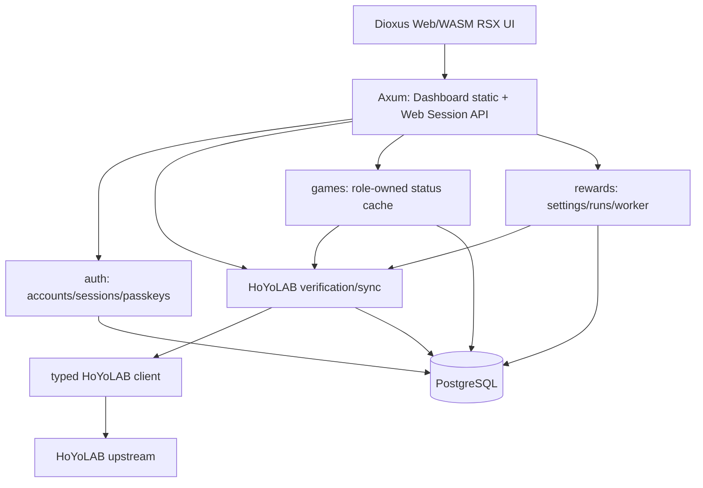
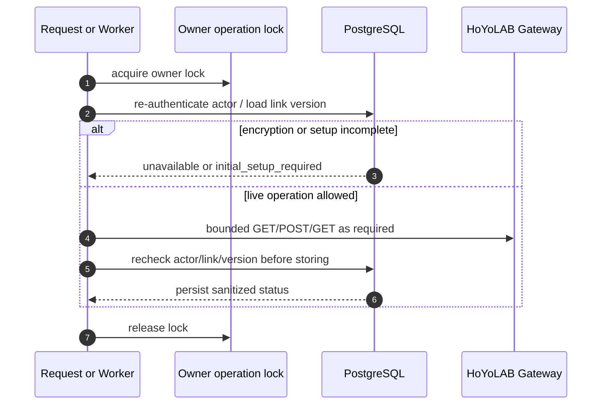
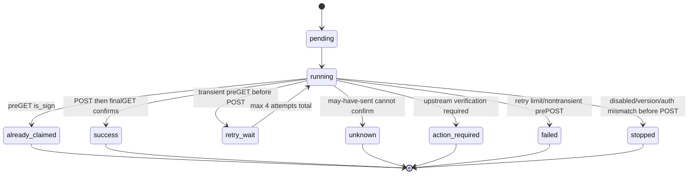

# AttOsHoYoDashboard 実装設計案

## 1. 構成

単一Rustバイナリの`serve`でAPIとDashboardを同じAxum HTTP listenerから提供する。Tokio runtime、SeaORM + PostgreSQL、Argon2id、WebAuthnを使い、DashboardはDioxus 0.7.10 Web/WASM RSXを配信する。UIはstandalone workspace crate `dashboard-ui` / package `attos-dashboard-ui` で構築し、`dx build --package attos-dashboard-ui --platform web --release` のpublic出力を `DASHBOARD_UI_DIR` から配信する。公式Dioxus Components由来のButton/Card/Card partsをDioxusLabs/components `9a758255ea26e2b20c8cecf4c1c946feb9e71da7`（MIT）からsource templateとして同梱し、`dioxus-primitives` も同じimmutable SHAにpinする。SSR/fullstack server、native app、CDN、危険なHTML injectionや`document::eval`は使わない。

責務:

- `dashboard-ui/src/app.rs`: App合成・起動・60秒周期のDashboard更新。`app/state.rs`はAppState・Page/Phaseと状態操作、`data.rs`は画面データ取得（未取得はNoneで空と区別）、`session.rs`はbootstrap・fresh me・初期設定ゲートのその場での再読み込み（Loading画面なし）・logout、`actions.rs`は非同期操作のadmission（session generationとは別のaction token）/完了/エラー、`display.rs`は表示整形、`navigation.rs`は固定の同一Origin通常パスとHistory API・認証状態に応じたcanonical転送を持つ。bootstrapがbusy（app-shell fieldsetのロック）を持つのは`/me`とゲート（server settings、初期設定ではHoYoLAB連携）の読み込みまでで、ready shellのページデータ（HoYoLAB待ちで数秒かかるゲーム状態を含む）は通常の画面遷移と同じくbusyなしで読み込む。こうしないとロード中はヘッダーのメニューボタンが見た目は通常のまま無効になる。generation（bootstrap・sign-out・owner切替でのみ更新）による古い応答の破棄、busyによる重複抑制、`/docs`入場時は`/me`を確認しない`Unchecked`で、Docsを離れるときにbootstrapする、owner切替の初期化・初期設定の画面制限を維持する。
- `dashboard-ui/src/app/preferences.rs`は言語・テーマだけの永続化、`credentials.rs`はWeb Cryptoによる仮パスワード生成とclipboard境界を持つ。秘密・表示状態は永続化しない。
- `dashboard-ui/src/pages/`: `auth`・`shell`・`dashboard`・`hoyolab`・`accounts`・`rewards`・`security`・`admin`・`deletion`・`docs`・`about`に画面責務を分け、`common`にField/Metric/PasswordInputなどを置く。`challenges`はダッシュボードの各ゲームカードに入る「高難度コンテンツ」欄（ステータスとログインボーナスの間）で、`dashboard`の共通`Clock`と`Freshness`を使う。`about`は作者・ライセンス（`GPL-3.0-or-later`、mainブランチの`LICENSE`へリンク）・リポジトリURLをUI crateのCargo metadata（`authors`・`license`・`repository`）から表示し、バージョンは配布物ごとに分ける（アプリはUI crateの`version`、web版はルート`Cargo.toml`の`[package] version`。`docs/versioning.md`）。メニューではAPIドキュメントの直下に置く。アプリのメニューは「ブラウザで開く」、HoYoLAB、「このアプリについて」の順に置き、「設定」は下部ナビゲーションかヘッダーの設定ボタンから開く。AHD R3はサイドバーなしの右drawer、5つの設定タブ、desktopの2ゲーム同時表示とmobileのゲームタブを使う。UID選択・status取得はゲームごと、automation変更と時刻保存は`app/data.rs`の共有処理を通す。`api.rs`・`models.rs`・`webauthn.rs`はHTTP・DTO・ブラウザ認証器境界を持ち、localStorage secrets、manual Cookie/Origin header、SSR/fullstack serverは持たない。
- `dashboard-ui/src/components/`: official Dioxus Components由来Button/Card/Card partsとMIT/provenance。
- `dashboard-ui/src/pages/swipe_tabs.rs`・`dashboard-ui/src/app/swipe.rs`: タブの横スワイプは`swipe_tabs`の`SwipeableTabs`がパネルを包んで扱い、タブバー・キーボード操作・タブ状態（`AppState`やURLの`Page`）はそのまま、スワイプはタップと同じ`on_change`を呼ぶ。判定は`app/swipe.rs`に一つだけ置き（50px以上、または30px以上かつ0.5px/ms以上の速さ、横が縦の1.5倍超、画面端24px以内の開始・ページのスクロール・二本指は除外）、web版はweb-sys、アプリは`document::eval`でタッチだけを受動リスナーで集める（マウスでは動かず、縦スクロールを妨げない）。フォーム部品・`data-swipe-ignore`・横スクロールする要素から始めたタッチは無視する。mobile（900px以下）のゲームタブは`dashboard`がパネル群（`#game-panels`）を`SwipeableTabs`で包み、左右のスワイプでも切り替える。タブ状態は`AppState.dashboard_game`だけに持ちURLには載せないため、スワイプもタップと同じくこれを書き換える。2ゲームを同時表示する幅では無効にする。設定タブは`shell`が`#settings-panel`を`SwipeableTabs`（`#settings-swipe`、幅によらず有効）で包み、`settings_tabs`の順（アプリは削除を除く）で切り替える。スワイプはタップと同じ`set_page`を通るのでURL・履歴・選択状態・データ読み込みが揃い、矢印キーと違って端では循環しない。報酬のON/OFFスイッチ（`input[role=switch]`）や時刻の`select`の上から始めたスワイプでは切り替わらない。横スクロールするタブバー（アプリ）は、選んだタブが見えるよう横方向だけスクロールする。web版はCSPのため`document::eval`を使わない。
- `dashboard-ui/src/mobile/http.rs`・`dashboard-ui/android/MainActivity.kt`（`AhdSessionStore`・`AhdSessionFormat`）: アプリのセッションCookie jarはRustが持ち、保存はKotlinがAndroid Keystoreの鍵（`ahd_session_cookies`、AES-256-GCM、ユーザー認証なし）で暗号化した`files/session-cookies.enc`に行う。RustはJNI（`notify::call_on`）で`read`・`write`・`clear`を呼び、受信箱とウィジェットのジョブは`cookieHeader`を直接使う。`read`が失敗（null）のときRustのjarは未読み込みのまま要求を通信エラーとして失敗させ、ログアウトにしない（Kotlinは5分以上・5回以上続いた一時的な失敗で諦める）。保存に失敗したjarは次の要求の後に保存し直す。Kotlinはファイル操作を1つのロックで排他する。復号できないファイルは消してログアウト扱い、旧平文`session-cookies.json`は最初の読み込みで暗号化して消す。両ファイルはバックアップ規則（`android/res/xml/ahd_*_rules.xml`）で除外する（`docs/android-changes.md` 5.7）。
- `src/dashboard/http/mod.rs`: API・static route compositionと単一HTTP listener・worker lifetime。`ui.rs`はcompiled UI・通常パスの`/login`／`/dashboard`／各`/settings/...`／`/admin`／`/about`・公開`/docs`・`/assets`・`/openapi.json`を提供し、`/settings`を`/settings/games`へ308転送する。未知のパスやAPIをSPAへfallbackしない。CLIの`serve`がmigrationと空DBの初期管理者作成を行い、事前に構築したAccountsをserverへ渡す。
- `src/dashboard/auth/`: user lifecycle、password/session、passkey registration（resident key preferred）/authentication（ユーザー名指定とdiscoverable）、deletion requestと削除完了のretry backoff。`passkeys/decoy.rs`は利用可能なpasskeyのないユーザー名に返す、実ユーザーと同じ形のpasskey login options（完了できないchallengeとHMAC由来のcredential ID 1件）を作る。`app_logins.rs`はAndroidアプリのブラウザ経由ログイン（PKCE S256）を扱う。ブラウザのセッションが承認したchallengeを、ハッシュ化したワンタイムコード（120秒・最大256件・プロセス内メモリ）に結び付け、交換時はコードを先に消費してからverifierを定数時間で比較し、user lockの中で承認したブラウザのセッションがまだ有効なことを確かめてから新しいセッションを発行する（管理者の復旧・無効化・削除やブラウザのログアウトで未交換のコードも無効になる）。`login_limit.rs`がpassword・passkey共通のユーザー名ごとのログイン試行枠と、ログイン中の現在パスワード確認（パスワード変更・削除要求）のユーザーIDごとの別枠を持つ（HTTPはIPやglobal枠を持たない）。
- `src/dashboard/hoyolab/`: owner operation lock、identity/roles整合性検証・sync。`health.rs`は管理者のユーザー一覧向けの連携状態（link状態・本人確認日時・ゲーム状態の最終取得成功日時・報酬設定ごとの自動受け取りと直近に終わった実行の状態・日時・最後の試行のsanitized error code）を保存済みの行だけから集計し、HoYoLABを呼ばない。「要対応」の判定（`cookie_invalid`、または`verified`の連携で設定の`action_required`か直近の実行が`failed`・`action_required`・`unknown`）もここに1つだけ置く。Cookie・UID・ゲームデータ・上流raw errorは持たない。認可は呼び出し側の`auth/administration.rs`（`Accounts::user_overview`がfreshなセッションで管理者を確認）に残す。`credentials.rs`がCredentials/CookieKeyの窓口を持ち、`credentials/parser.rs`がCookie解析・正規化、`credentials/crypto.rs`がAES-256-GCM保存を担当する。Cookie claimは本人確認の証拠にせず、暗号化v1のnonce・AAD・保存形式は維持する。
- `src/dashboard/games/`: owned game UID list、visibility、curated status cache（`service.rs`）、高難度コンテンツの要約cache（`challenges.rs`、上流JSONの防御的な読み取りは純関数の `challenge_summary.rs`）。`challenges.rs`は`Games`の別implとして`service.rs`の認可・`action_required`判定・保存前の再確認を共有し、方針を重複させない。`live_tests.rs`は既定ignoreの別承認付き派遣GET検査で、ローカルdevenvの保存済みCookieをメモリ内で使用し、DB read-only transactionと件数・状態・公式画像hostだけの非機密出力を要求する。
- `src/dashboard/rewards/service.rs`: settings・manual enqueue・historyと共通のactor/link/credential version再検査。`service/cache.rs`がrefresh・TTL・cache upsertを持つ。認可再検査はcache専用ではないためserviceに残す。
- `src/dashboard/rewards/service/worker/`: serviceの子workerを維持し、`scheduler.rs`にtick・due schedule・history cleanup、`attempt.rs`にprepare・POST・GET確認、`state.rs`にdurable may-have-sent・guard・完了transaction、`deletion.rs`に削除時のGET-only確認を置く。owner operation lock、DB transaction/row lock、POST前のdurable記録と不確定時の再送禁止は移動前と同じ境界を保つ。fixed-offset計算は`rewards/schedule.rs`、guardを報酬日（UTC+8の0時区切り）に限定する共通判定は`rewards/guard.rs`。削除完了前の報酬側判定（未解決guard・`may_have_sent` runの抽出、Cookie keyなしでは削除を保留）は`rewards/deletion.rs`が持ち、HTTP runtimeは呼び出すだけにする。
- `src/hoyolab/client/`: typed upstream protocol client。Dashboard policyをここへ混ぜない。

APIとschedulerは同じDB/業務処理を使う。単一process/instance前提で、Redisや分散queueはない。更新時down timeは許容する。

### 1.1. DioxusとAPI/UI境界

現構成はDioxus Webのclient-side rendering + Axum REST APIで、`serve`がUIとAPIを同一process・portで提供する。ブラウザは同一Originの相対`/api/v1/...`を直接使い、内部HTTP proxyやCORSはない。DockerはAlpineベースの`app`と`db`だけで、appはRustバイナリを直接起動する。`scripts/`は開発・テスト専用で、本番Dockerから除外する。DBの本番初期化はPostgreSQLイメージの`POSTGRES_USER`・`POSTGRES_PASSWORD`・`POSTGRES_DB`だけで行い、初期化SQLは使わない。アプリ用roleはアプリ専用DBコンテナのsuperuserとなるため、DBポートは公開しない。公開時は`PUBLIC_ORIGIN=https://ahd.example.com`、`RP_ID=ahd.example.com`とし、外側のHTTPS reverse proxyからパスを変更せず転送する。

[Dioxus 0.7 Fullstackのserver functions](https://dioxuslabs.com/learn/0.7/essentials/fullstack/server_functions/)はAxum互換endpointと型付きclient呼び出しを生成する。新規のUI専用Rustアプリなら、手書きURL/JSON transportとDTOの二重管理を減らす有力な選択である。業務serviceやAxumを捨てる必要はない。一方、認証・Origin/Cookie・fresh authorization・mutation single-flight・owner切替・safe error・POST不確実性の処理は自動的には代替されない。

現時点ではSSR/SEO要件はなく、既存REST/OpenAPIと安全境界を維持してWeb構成を継続する。server functionsへの全面移行や新しい共有contract crateは今回導入しない。共有型を検討する場合も、backend entityをWASMへ持ち込まず、HTTP DTOのserde flatten/default/nullability・日時表現とUIのcurated型の差を確認する。全response modelが同じ宣言の単純重複ではない。

### 1.2. 既存ライブラリによる簡素化

- SeaORMの明示的`ON CONFLICT`でgame/reward cacheとrole保存の事前SELECT・insert/update分岐を削除。cacheはnullableを含む6列を更新し、roleは検出flag/時刻のみ更新する。既存ID・visibility、失敗時payload保持、transaction/owner lockは維持する。
- 既存lock内の`derive_more 2.1.1`をrootの直接依存として`debug` featureのみ宣言し、11 entityの手書きDebugをstatic container formatへ置換。表示fieldのallowlist方式であり、新fieldを自動公開するdefault Debug/secret denylistではない。compact/pretty両形式を検証する。pretty表示はflatとなる。生成ActiveModelは引き続きログ禁止。
- Randの`Alphabetic.sample_string`でDS用6文字ASCII nonceを生成。web-sysのtyped credential gettersを利用し、独自reflectionを削除。action終了処理は既存の同期admission/root taskへ集約し、docs取得はDocsPageが単独所有する。
- Cookie保存・admin user作成はclientが成功2xxをackとして扱い、未使用の成功JSONをdecodeしない。後続の型付きmetadata/user list取得を正本とする。backend/OpenAPIのJSON応答契約は変更しない。成功bodyの検証・消費・size capを行うという主張はしない。
- Cookie parserをCookieJarへ、native WebAuthn bridgeを`webauthn-rs-proto 0.5.5`のWASM変換へ置換しない。前者は重複Cookieの証拠・空白等の現policyを保持できず、後者はextension console logging、null userHandle、transports消失に相違がある。認証/session/cron/repositoryの新frameworkも追加しない。

## 2. HTTP境界

- Protected routeはsession cookieをDB上のhashへ照合する。HTTPS時のcookie名は `__Host-attos_session`、localhost非secure時は `attos_session`。
- Safe method以外は `Origin` headerが `PUBLIC_ORIGIN` と完全一致する必要がある。ただし `Authorization: Bearer` がちょうど1つあり `Cookie` headerを持たない要求は除く。CSRFには自動で付く資格情報が要るが、ブラウザはcookieを自動で付けても、Bearer headerはCORS preflightなしにcross-siteで付けない。AHDはpreflightに応じない。
- `Authorization` headerがある要求はAPIトークンだけで認証し、セッションcookieも持つ要求は401とする（`auth/api_tokens.rs`）。scope `read` はdashboardデータの読み取り8ルート（`GET /me`・`/server-settings`・`/me/hoyolab`・`/game-accounts`・`/game-accounts/{id}/status`・`/game-accounts/{id}/challenges`・`/reward-settings`・`/reward-runs`）、`run` はそれに `POST /reward-settings/{id}/run` を加える。判定はmiddlewareがrouterのmatched pathで `permits` を呼んで行う。その他のrouteはセッション専用で、業務層の再認証もセッション専用の `Sessions::authenticate` のままにする。トークンで届くroute（`CookieStore::actor_locked`・`status`）だけが `sessions::reauthenticate` で資格情報の種類ごとに再認証する。
- Responseには `X-Content-Type-Options: nosniff` を付与する。API・HTML shell・error responseは `Cache-Control: no-store`。`/assets` の成功responseのうち、content hash付きの名前（DXの`-dxh<hex>`、self-hosted fontの`-<sha256先頭12桁>`）は `public, max-age=31536000, immutable`、それ以外は `no-cache` とする。Dioxus HTML shellにはCSPも付与する。DX 0.7.10のexternal module loaderを許可し、`script-src 'self' 'wasm-unsafe-eval'`、`style-src 'self'`、`img-src 'self' https://upload-os-bbs.hoyolab.com https://act-upload.hoyolab.com https://act-webstatic.hoyoverse.com`、`connect-src 'self'`、`object-src 'none'`、`frame-ancestors 'none'`、`base-uri 'none'` を使う。`'unsafe-inline'` と一般の `'unsafe-eval'` は使わない。release bundleのCSP・WASM動作はChromiumと合成fixtureで検証済み。
- Body limitは16KiB。JSON DTOは `serde(deny_unknown_fields)` を使う。
- Error DTOは `{ "error": code, "message": sanitized }`。上流message、driver source、秘密値は返さない。

## 3. データモデルと保持

| Entity | 役割 |
|---|---|
| `users` | username, admin flag, active, must_change_password, password hash |
| `sessions` | token hash primary key, fixed expiry |
| `api_tokens` | user、name、scope（`read`/`run`）、token hash unique、created_at、last_used_at。失効は行の削除、履歴はaudit |
| `passkeys` | WebAuthn credential JSON, credential id, label |
| `audit` | lifecycle audit; secret/game dataは含めない |
| `hoyolab_accounts` | owner 1:1、nullable verified UID unique、encrypted credentials、credential_version、auth_status |
| `game_accounts` | link配下のgame_kind/game_uid/region、visible、detected、last_detected_at |
| `game_status_cache` | UIDごとのlatest curated payload version 2、fetched/error timestamps |
| `game_challenge_cache` | UIDごとの高難度コンテンツ要約（モードの配列、payload version 1）、fetched/error timestamps、game account削除でcascade |
| `reward_settings` | link × game、enabled、local_time、auth_status、next_run_at |
| `reward_runs` / `reward_attempts` | durable reward execution and attempts, 5-day history |
| `reward_guard` | POST may-have-sent durable guard |
| `deletion_requests` | inactive target deletion completion queue |

CookieはAES-256-GCMで保存し、AADに用途/version/owner/verified UID有無と値を含める。keyはDB外の `HOYOLAB_COOKIE_KEY`。key rotation/re-encryption toolingは未実装。

## 4. HoYoLAB連携と利用条件

ユーザーは実アクセス・手動および定期の報酬受け取りを趣味用途の通常機能として承認した。`HOYOLAB_COOKIE_KEY`による暗号化設定と既存の連携検証成功を条件に利用できる。自動受け取りは初期OFFのままユーザーが既存UIから有効にする。

確認処理は、v2 ltoken credential、fresh account identity、fresh community identity、Cookie claimed UID一致、既存UID一致、roles validation、credential version再確認、same-UID update preservationを要求する。Cookie UIDだけを本人確認の証拠にはしない。認証・認可・アカウント利用可否とverified link要件も維持する。

利用承認は実上流のtoken-to-UID binding・roles principal一致やreward POST契約全体の科学的実証ではない。実アカウントは1個のみ。ユーザー提供のcurrent read-only GET suite成功はアクセスの確認であり、identity GETやreward POSTは対象外で、実POST結果も報告されていない。合成multi-identityテストではlive bindingを証明できない。

## 5. Owner operation ordering

Lockはowner単位で、別ユーザーはglobal serializeしない。DB table lockはbootstrap empty-table check以外に長時間使わず、admin lifecycle（無効化・再有効化、仮パスワード復旧、削除要求）はPostgreSQL advisory transaction lockを先に取り、その後にuser rowをID順でlockする。削除待ちのユーザーには再有効化も仮パスワード復旧も行わない。再有効化は全セッションを失効させたまま、対象のreward settingを`enabled = false`・`next_run_at = NULL`にする（無効化中の放置後に本人の確認なく自動POSTを再開しないため。時刻は保持し、本人が再度有効にする）。パスワード（Argon2）とWebAuthnのCPU処理はSQL transaction・row lockの外で行う。discoverable loginはuserHandleを未検証の検索ヒントとして扱い、readyなユーザーとそのcredential IDを確認して試行枠を消費した後にworkerで署名検証する。両方式共通のpasskey login finishは署名検証とcounter更新の計算をlockなしのsnapshotで済ませ、user lock取得後にcredential行のUUID・credential ID・fingerprintが同じことだけを確かめて書き込む。DB接続プールは16本（`db/mod.rs`の定数）。

## 6. Game status cache

- `Games::status` は ready verified link と owned game account を要求する。
- hidden/undetectedならfetchせずcache projectionを返す。
- fresh cache条件は payload version 1、payloadあり、`0 <= now - fetched_at <= 5min`。
- upstream successではcurated summaryだけを保存する。failureでは旧payload/fetched_atを保持し、error_code/error_atを更新する。
- retcode 10102（戦績・リアルタイムノート非公開）はgame statusのerror_codeとしてだけ表示し、reward settingは変更しない（ログインボーナスは戦績の公開設定に依存しない）。直近5分以内の10102はnote再取得を控え、それ以降は再取得して公開設定の変更から自動で回復する。cookie invalid classはlinkを `cookie_invalid` にする。

### 6.1 Endgame challenge cache

- `Games::challenges` は `status` と同じ所有者ロック・ready verified link・owned/visible/detected・`action_required`・保存前再確認を使う（セッションとAPIトークンのどちらでも呼べる。トークン経路は `ready_link`／`actor_locked` の `reauthenticate`）。
- 上流は `attoshoyodashboard::challenge::Challenge`（モード・パス・クエリ）ごとのGETで、型付けせずJSONのまま `challenge_summary::summarize` に渡す。要約は `ModeSummary`（全フィールドnullable）。キャラクター別戦績は読まない。
- fresh条件：payload version 1、payloadがモード配列として読める、cache全体のerror_codeなし、`0 <= now - fetched_at <= TTL`、かつ取得後に終わった期間がない。TTLは全モード成功なら `CHALLENGE_CACHE_TTL_MINUTES`（既定60分）、一部失敗なら `STATUS_CACHE_TTL_MINUTES`。終わった期間を取得後に検出したときだけ取り直すので、上流が終了済みの期間を返し続けても再取得が毎回にはならない。
- 取得はモードを順に。Cookie無効なら中断してlinkを `cookie_invalid`。全モード失敗なら旧payload/fetched_atを保持してerror_code/error_atを記録、`upstream:10102` は `STATUS_CACHE_TTL_MINUTES` の間再取得しない。
- 時刻：Unix秒はそのまま、年月日時分のオブジェクトはサーバー（`os_usa`/`prod_official_usa` UTC-5、`os_euro`/`prod_official_eur` UTC+1、`os_asia`/`os_cht`/`prod_official_asia`/`prod_official_cht` UTC+8）の時刻。未知のサーバーは `null`。
- UI：`load_selected_status` は全ゲームの状態の後に各ゲームの要約を読む。UID選択と更新ボタンは `load_game`（状態→要約）。要約は `GameSelection.challenge_request` で状態とは別に最新の要求だけを反映する。404（エンドポイントのない古いサーバーにつないだアプリなど）は失敗として表示せず、欄ごと出さない。

## 7. Reward worker

Worker tick is independent of page views. It first cleans completed 5-day history while preserving interrupted active work for confirmation, enqueues due enabled ready settings, then processes pending/running/retry_wait runs up to a small batch. `mark_may_have_sent` persists the guard before POST. Unknown/may-have-sent paths never resend POST within the same HoYoLAB reward day (00:00 UTC+8 boundary, judged from the guard's `updated_at`); they use GET-only confirmation and otherwise remain unknown. Any GET confirming `is_sign=true` clears the guard, and a guard recorded on an earlier reward day no longer blocks scheduling, manual runs, or deletion. A successful POST still requires daily GET `is_sign` confirmation. Every daily GET the worker finishes with also refreshes the reward status cache. One failing run or setting is logged and does not abort sibling runs; a setting whose scheduling fails is retried after a short backoff. Schedule/ON updates take the owner operation lock, so an in-flight attempt cannot overwrite their `stopped` transition. Manual and scheduled runs retain verified-link, authorization, owner serialization, and transaction/row-lock checks; automatic rewards default OFF and are enabled by the user through the existing UI.

## 8. Deletion workflow

Deletion request verifies actor password, reauthenticates current session, locks actor/target consistently, rejects last active admin, marks target inactive, revokes sessions/passkeys, persists `deletion_request`, and records audit. Background completion waits for owner operations, confirms settings with an unresolved same-reward-day guard or a `may_have_sent` run by bounded GET-only logic (`rewards/deletion.rs`; without a cookie key such owners stay pending), then deletes target-owned data and user row. Target audit rows are removed; other rows where target was actor may be preserved with actor set null. The worker selects up to 32 oldest pending owners per tick, skipping owners already in progress and owners in retry backoff. A failed completion is retried after an in-memory per-owner exponential backoff (10 s doubling up to 1 h; reset by a restart or a successful completion), so a failing owner neither repeats HoYoLAB GETs every second nor starves later owners.

## 9. API contract

Manual OpenAPI 3.1 is maintained at [`../dashboard-api.json`](../dashboard-api.json). It documents API routes: auth, passkeys, admin/me, HoYoLAB status/cookie/verify/sync, game accounts/status/challenges, reward settings/runs, notifications (Webhook settings, app devices, inbox and push subscription), health, and `/openapi.json`. The standalone Dashboard's `/` and `/docs` are not API operations. The compiled `/assets/{...}` subtree is served from `DASHBOARD_UI_DIR/assets` for browser-internal hashed assets only and is not an OpenAPI operation.

## 10. App notifications and UnifiedPush

Personal notices reach the Webhook and, for registered app installations, a per-user inbox (`notifications/app.rs`). The app polls the inbox (`AhdInbox`, every 15 minutes through JobScheduler, every minute while visible); the inbox id is each installation's cursor, and the tag (deduplication key) keeps a notice and its predicted local twin from showing twice. UnifiedPush only shortens the wait: an installation may store a Web Push subscription (`PUT /api/v1/me/notifications/app-devices/{id}/push`), and every inbox insert POSTs an aes128gcm wake-up with a VAPID header (`notifications/push.rs`) that names no notice. The app decrypts it with its own keys and runs the same cursor-based poll, so push and poll can never show a notice twice and a lost push only waits for the poll. Endpoints are user-supplied and follow the Webhook URL rules; they are sealed like Webhook URLs, removed on 404/410, device removal, user disable and deletion request. The VAPID key derives from `HOYOLAB_COOKIE_KEY`. FCM is not used: no third-party credentials on the server and no dependency on Google services on the device.
