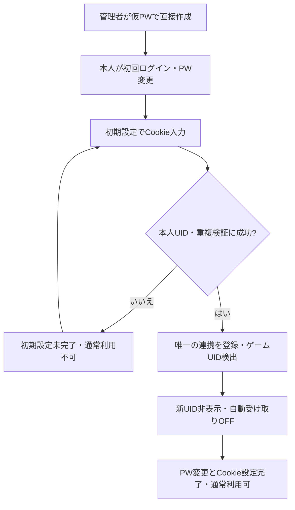

# AttOsGameDashboard 仕様書

## 1. 目的と対象

小規模な身内用のWebサービスとして、HoYoLABアカウントのログインボーナス受け取りとゲーム内リソースの確認を行う。スマートフォン・デスクトップのWebブラウザを対象とし、海外版HoYoLABの原神・崩壊：スターレイルに対応する。

以下はユーザーが承認した初期版の機能要件。基盤・認証のバックエンドは実装済みだが、**Cookie初期設定・通常利用ゲート・Dashboardユーザー削除・HoYoLAB連携・受け取り・Dashboard表示は未実装**であり、本仕様全体の完了とは扱わない。実装状況と確認済みの範囲は作業計画で管理する。[技術設計](../design/AttOsGameDashboard.md)と[作業計画・検証課題](../plans/AttOsGameDashboard.md)は別文書で管理する。

## 2. 利用者と権限

### 2.1. 利用開始・認証・復旧

| 利用者 | できること |
|---|---|
| 管理者 | ユーザーの直接作成、無効化・再有効化、仮パスワードによる復旧 |
| 一般ユーザー | 自身のHoYoLAB連携、UID表示、受け取り、パスワード・任意のパスキーの管理 |

- 招待・自由登録はない。管理者が仮パスワードを設定してユーザーを直接作成する。
- Cookie設定はアカウントの初回登録時に行う。管理者が仮登録したユーザーは、本人の初回ログイン時の初期設定で行う。招待・自由登録を追加するものではない。
- 初回の通常利用前に、本人による仮パスワード変更とCookie設定・HoYoLAB本人UID検証の両方を完了しなければならない。Cookie入力未完了・所有UID検証不能では通常利用できない。復旧後も仮パスワード変更は必須。
- パスワード復旧は既存ユーザーの認証復旧であり、新しいHoYoLAB UIDの選択・置換を許可しない。既存連携のCookie更新は同一UIDに限る。
- パスワードの保持は必須。パスキーは任意で追加でき、通常ログインに使える。ユーザーを残してパスワードだけを削除する機能は設けない。
- 認証手段を失った場合の復旧は、管理者による仮パスワード再設定のみ。再設定リンク・メールは使わない。
- 復旧時は対象ユーザーの全セッション・全パスキーを削除し、復旧操作（操作者・対象・日時）を記録する。秘密値は記録しない。
- 通常のWeb画面・APIからゲームデータを閲覧・操作できるのは所有者のみ。管理者も他人のゲームデータを直接閲覧できない。
- **管理者は認証を復旧できる信頼主体**であり、復旧権限を通じて本人としてログインし得る。通常画面の所有権制限は、この管理者の信頼境界をなくすものではない。

### 2.2. セッション

- セッションごとに、成功ログインの時点から初期7日間の有効期限を設定する。期間はサーバー設定で変更できる。
- アクセスによる延長はしない。別端末のログインは新しいセッションだけを発行し、既存セッションを延長しない。
- 期間設定の変更は、変更後のログインにだけ適用する。発行済みセッションの期限は変えない。
- ログアウトは当該セッションを失効させる。ユーザー無効化・復旧は対象ユーザーの全セッションを失効させる。

### 2.3. 無効化・再有効化

| 操作・状態 | 挙動 |
|---|---|
| 無効化 | Web/API利用・ログイン・新規実行・再試行を禁止し、セッションを失効させる。ゲームデータ・履歴・設定・通常パスワード・パスキーは保持 |
| 操作送信後の無効化 | 送信済み操作の結果確認・記録までは継続する。新たな受け取りPOSTや再試行は行わない |
| 再有効化 | 旧セッションを復活させず、再ログインが必要。自動受け取りは全ゲームOFF。その他設定・履歴・通常パスワード・パスキーは保持 |

## 3. HoYoLAB連携とゲームUID

### 3.1. 管理単位

1ユーザーにつきHoYoLABアカウントは1個。その連携に複数のゲームUIDが紐づく。初期設定未完了の仮登録ユーザーは未連携だが通常利用できない。独立した連携解除は設けず、解除はDashboardユーザー削除時だけ行う。

| 機能 | 単位 |
|---|---|
| Cookieの初回設定・同一UID更新 | ユーザー唯一のHoYoLABアカウント |
| アカウント削除（連携の削除を含む） | Dashboardユーザー |
| ログインボーナスの設定・受け取り | HoYoLABアカウント × ゲーム種別 |
| スタミナ・派遣などの取得と表示選択 | ゲームUID（ゲーム種別・リージョンを含む） |

UIDの非表示・未検出は、該当ゲームの受け取り設定に影響しない。表示選択は所有権の変更ではない。

### 3.2. 初回登録・初期設定の流れ

Cookieは初回登録の一部であり、仮登録では本人の初回ログインの初期設定に含める。PW変更完了だけでは通常利用を許可しない。表示UIDの選択、自動受け取りON、パスキー追加は任意。自動OFFのままでもDashboardと手動受け取りを利用できる。

### 3.3. 登録・同期・Cookie更新

- Cookieは全文貼り付け、または個別項目入力を想定する。`ltuid_v2`・`ltoken_v2`の最小pairは公開ソース由来の候補であり、十分性は未実証。必要MIDを含む入力契約は[本人UID検証ゲート](../plans/AttOsGameDashboard.md#21-hoyolab本人uidの検証候補と実装ゲート)の確認後に確定する。
- 初回設定時に認証・HoYoLAB本人UID・重複を検証し、失敗した場合は連携を登録せず通常利用を許可しない。Cookie内のUID claimやrolesのゲームUIDを本人UIDの証明にしない。同一HoYoLAB UIDは全ユーザーで一意、所有者も一意。重複拒否時に既存所有者を開示しない。
- Cookie更新は**同一HoYoLAB UIDのみ**受け入れ、設定・履歴・連携の同一性を保持する。別UIDへの置換も、追加の別連携としての登録も拒否する。
- Cookieは自動更新しない。失効時は所有者が手動更新・再検証する。
- UIDは自動検出し、再同期できる。新規UIDは常に非表示。
- 再同期で見つからなくなったUIDは未検出として管理画面に保持する。ホームから外し、未検出中はゲーム状態を取得しない。
- 未検出前の表示選択を保持し、再検出時に復元する。

### 3.4. Dashboardユーザー削除と操作の順序

- 「アカウント削除」はDashboardユーザー削除を意味する。独立したHoYoLAB連携解除は提供しない。
- ユーザー削除は不可逆。ユーザー本体・Cookie・本人HoYoLAB UID・配下のゲームUID・設定・キャッシュ・受け取り実行／試行履歴・PW・全セッション・全パスキー・関連challenge等の全ユーザーデータを完全削除することを確認してから実行する。
- 削除完了時にHoYoLAB UIDの一意制約を解放する。別ユーザーもそのHoYoLAB UIDを登録できる。
- 削除後の登録は新規ユーザーとして扱い、旧データを復元しない。新UID表示も自動受け取りも全OFFとし、初回設定を改めて行う。
- Cookie更新・ユーザー削除は、処理が実行中という理由だけでは拒否しない。同じ連携の操作と順序化し、HoYoLABとの通信・結果確認中なら待機する。
- 削除では新規実行・再試行・未送信操作を禁止する。送信済み操作は必要な結果確認・記録を済ませてから全データを削除する。再試行遅延の終了までは待たせない。
- 別ユーザーの連携操作は妨げない。
- 削除を実行できる主体（本人／管理者）、最後の管理者の保護、確認画面・API契約の詳細は未確定。既存の管理者権限から削除権限を推定しない。

## 4. ログインボーナス

### 4.1. 設定と実行

| 条件・操作 | 挙動 |
|---|---|
| 初回設定での新規連携 | ゲーム別の自動受け取りはOFF、初期実行時刻06:00 |
| 自動ON・設定時刻到来 | 状態をGET確認し、未受取なら受け取りを実行 |
| 自動OFF | 自動実行しない。手動受け取りは可能 |
| 手動受け取り | 所有者が実行。自動ON/OFFから独立 |
| ON直後・Cookie更新直後 | 自動実行を即時には行わず、次回設定時刻まで待機。今すぐなら手動 |
| すでに受取済み | POSTせず既受取として終了 |
| サーバー停止で設定時刻を逃した | 復旧後、現在受け取れる分だけcatchup。過去期間の補填はしない |

- 設定単位はHoYoLABアカウント × ゲーム。所有者はゲーム別のON/OFF・実行時刻を設定する。
- タイムゾーンだけはサーバー共通の固定UTCオフセットで、初期UTC+09:00。ユーザー別・ゲーム別のタイムゾーン設定やサマータイム対応はない。
- 同じ対象の同時実行と二重送信を抑制する。厳密な一度だけの外部送信は保証しない。
- 受け取り期間はHoYoLAB側の状態を基準とし、JSTの日付だけで受取済みや期間キーを保証しない。リセット境界は未実証。
- 成功はPOST応答だけでなく、最終的な受取状態を確認して判定する。
- catchupや再起動復旧を、不明処理の無条件POST再送に使わない。
- 自動受け取りはDashboardの閲覧状況に依存しない。

### 4.2. 実行状態と履歴

| 実行状態 | 意味 |
|---|---|
| 待機 | 実行待ち |
| 実行中 | 状態確認・受け取り・結果確認中 |
| 既受取 | 実行前から受取済み |
| 成功確認 | 受け取り後に受取済みを確認 |
| 再試行待ち | 一時障害により次の試行を待機 |
| 不明 | 最終状態を確認できず打ち切り。Dashboardに表示 |
| ユーザー操作待ち | Cookie更新・ゲーム固有追加認証などが必要 |
| 失敗 | 再試行上限などで終了 |
| 停止 | 無効化等で未送信の実行・再試行を中止 |

- 一時障害は指数バックオフで再試行し、**初回とは別に最大3回**（最大4試行）とする。
- POSTの結果が不明ならGETによる確認を優先する。確認不能なら不明として打ち切り、無条件のPOST再送はしない。
- 実行と試行の履歴は5日間保持し、自動・手動の別、実行日時、結果、対応が必要な状態を表示する。

### 4.3. 認証状態と停止範囲

認証状態は連携・ゲームが利用可能かを表し、実行状態は個々の処理結果を表す。両者を混同しない。

| 原因 | 停止範囲・復旧 |
|---|---|
| Cookie失効 | 該当HoYoLABアカウント全体の取得・受け取りを停止。Cookie更新・再検証が必要 |
| ゲーム固有の追加認証 | 該当ゲームの処理を停止。他ゲームは止めない。ユーザー対応後の再検証が必要 |
| 通信障害 | 当該処理だけを失敗・再試行対象とし、連携全体をCookie失効扱いにしない |

Cookie更新は過去の不明処理を成功扱いにせず、直ちに再送もしない。非公開設定や追加認証の実際の応答・解除判定は[実証課題](../plans/AttOsGameDashboard.md#2-実装前に実証すること)として残す。

## 5. Dashboard

### 5.1. 初期表示範囲

所有者が表示対象に選び、現在検出されているUIDの状態をホームに表示する。

| 原神 | 崩壊：スターレイル |
|---|---|
| 天然樹脂・満タン予測 | 開拓力・満タン予測 |
| 探索派遣 | 予備開拓力・依頼 |
| 洞天宝銭 | デイリー訓練 |
| デイリー任務 | ログインボーナス状態 |
| ログインボーナス状態 | — |

ログインボーナスは両ゲームで表示し、その単位はHoYoLABアカウント × ゲームである。UID表示とは独立に設定・状態・履歴を確認できる。連携のCookie状態とゲーム別追加認証状態も確認できる。

参量物質変化器・週間項目は、詳細なレスポンスと意味の実証が済むまで初期表示に含めない。

### 5.2. 更新とエラー表示

- ロード中・未取得・古いデータ・取得日時・Cookie失効・通信障害・非公開／追加認証などを、確認できた根拠に応じて区別する。欠落フィールドだけで非公開・非対応などと断定しない。
- 取得失敗時に旧データがあれば最終取得日時とともに表示し、最新値として扱わない。
- 満タン予測・カウントダウンには意味・単位を確認できた回復情報を使う。推定不能なら予測を表示せず、取得した数値を勝手に増やさない。
- 予備開拓力の数値上限や回復時刻など、既存型で裏付けられない数値を補わない。
- キャッシュはゲームUIDごとに最新1件のみ保持する。
- 通知はDashboard内のみ。Push・メール通知は行わない。

## 6. Web画面

| 画面 | 機能 |
|---|---|
| ログイン・初期設定 | ログイン、初回・復旧後の必須仮PW変更、仮登録ユーザーの初回Cookie設定。両条件完了前は通常利用不可 |
| Dashboardホーム | 選択・検出中UIDの状態、受け取り・連携状態 |
| HoYoLABアカウント管理 | 唯一の連携の同一UID Cookie更新、UID同期、未検出UIDの管理。追加連携・個別解除・複数アカウント選択なし |
| Dashboardユーザー削除確認 | 全ユーザーデータの不可逆削除確認。実行主体・画面の配置は未確定 |
| ゲームUID表示設定 | 表示選択。新UIDは非表示、再検出は元の選択を復元 |
| 自動受け取り設定・履歴 | ゲーム別ON/OFF・時刻、手動受け取り、5日間の履歴 |
| セキュリティ設定 | 必須パスワードの変更、任意パスキーの追加・削除 |
| 管理者画面 | ユーザー直接作成、無効化・再有効化、復旧。管理者のみ |

## 7. WebセッションAPI

APIはWeb画面用のセッション認証APIだけを提供する。PAT・Scope・外部クライアント向けAPIは不要であり、外部向けの別認証を追加しない。Web APIの契約はOpenAPI 3.1で記述する。

初回Cookie設定を含む画面・親リソース・必要metadata、ユーザー削除の権限／エンドポイントも未確定。エンドポイントとJSON契約の細部は[API設計案](../design/AttOsGameDashboard.md#5-api設計案)と[残る未確定事項](../plans/AttOsGameDashboard.md#3-未確定事項と要確認点)を参照。

将来のスマホアプリ対応希望はあるが、初期版にネイティブアプリやアプリ向け認証は作らない。UIと業務処理の分離だけを維持し、先回り実装はしない。

## 8. 機密情報の取り扱い

- HoYoLAB Cookieはパスワード同等の秘密情報として暗号化保存し、平文をブラウザ・APIへ返さない。
- パスワードは平文保存しない。仮パスワードを含め、Cookie・パスワード・セッション秘密値をログ・トレースに残さない。
- 認証、CSRF対策、リソース所有権・操作権限の検証を維持する。管理者の復旧権限は2.1節の信頼境界として扱う。

## 9. 初期版の対象外

- 招待・自由登録、ユーザーを残す単独パスワード削除、リンク・メールによる復旧
- PAT・Scope・外部クライアント向けAPIと別認証
- Push・メール通知
- Cookieの自動更新
- 複数HoYoLABアカウント連携・選択、別UIDへの置換、個別unlink service／API／GUI
- CAPTCHAの自動突破
- ゲームデータの共有
- 中国本土版HoYoLAB、原神・崩壊：スターレイル以外のゲーム
- キャラクター戦績の網羅
- 参量物質変化器・週間項目（詳細実証まで延期）
- モバイルネイティブアプリ、サマータイム対応
