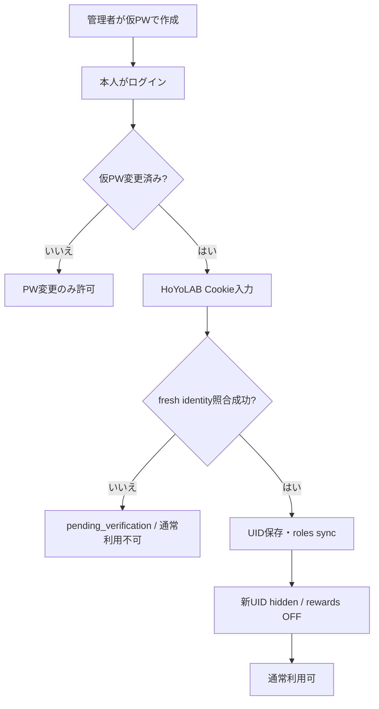

# AttOsHoYoDashboard 仕様書

## 1. 目的と現在の公開状態

AttOsHoYoDashboard は、小規模な身内用に HoYoLAB のゲーム状態確認とログインボーナス管理を行う Web Dashboard である。対象は海外版 HoYoLAB の原神と崩壊：スターレイル、利用者はスマートフォン・デスクトップのブラウザである。

現在のUIは Dioxus 0.7.10 Web/WASM RSX で作成する。UIはstandalone workspace crate `dashboard-ui` / package `attos-dashboard-ui` で、公式Dioxus Components由来のButton/Card/Card partsをsource templateとして使う。公開routeは `/`, `/docs`, `/openapi.json` で、`/` と `/docs` は同じcompiled Dioxus `index.html` を返す。`/docs` はread-only OpenAPI viewerで、認証やtry-it mutationは提供しない。Dioxus buildのhash付き `/assets/{...}` は内部assetであり、`/assets/app.js`・`/assets/style.css`・`/assets/docs.js` のような安定API routeは仕様に含めない。

HoYoLAB連携・手動報酬受け取り・自動報酬受け取りは通常機能として利用できる。Cookie暗号化の設定と既存のidentity照合・roles sync、パスワード変更を完了することが必要で、自動受け取りは既定OFFをユーザーがONにする。利用可能であることは、実上流token-to-UID bindingや報酬期間・POST反映契約の実証完了を意味しない。実GET疎通の成功、単一実アカウントやmockの結果だけでそれらを証明したとは扱わない。

## 2. 利用者、認証、セッション

| 利用者 | できること |
|---|---|
| 管理者 | ユーザー作成、無効化・再有効化、仮パスワード復旧、本人または他ユーザーの削除要求 |
| 一般ユーザー | 自身のパスワード変更、任意passkey、HoYoLAB Cookie登録、自身のゲーム状態・報酬設定、自己削除 |

- 招待・自由登録・PAT・Scope・外部クライアントAPIは提供しない。
- 認証はWebセッションCookieのみ。HTTPSでは `__Host-attos_session`、localhost HTTPでは `attos_session` を使う。Cookieは HttpOnly / SameSite=Strict、HTTPSでは Secure。
- セッションはログイン時から固定期限（既定7日）で、アクセスでは延長しない。パスワード変更は他セッションを失効させ、現在セッションの期限は延長しない。
- 初回・再発行後の必須パスワード設定は新パスワード＋確認のみを入力し、ログイン時の仮パスワードを保持しない。`PUT /api/v1/me/password` の `current_password` は、ユーザー行lock下で再認証した最新アカウントが `must_change_password=true` の場合のみ省略（またはnull）できる。通常変更は正しい現在パスワードが必須で、明示した不正な値は必須設定時も拒否する。新パスワードは省略時も保存済みパスワードと異なる必要があり、確認入力はクライアントで照合してAPIには送らない。失効・期限切れセッションや競合でhash/必須flagが変わったsnapshotは拒否する。
- mutationは同一Originを必須とし、`Origin` が `PUBLIC_ORIGIN` と完全一致しなければ拒否する。
- JSON DTOは未知fieldを拒否する。エラーは安全な `error` code とsanitized `message` で返し、Cookie・パスワード・セッショントークン・上流raw messageを含めない。
- ログイン入口は全体で毎分20リクエストに制限する。passkey CPU枠が満杯の場合は待機列を増やさず503を返す。

## 3. 初期設定と通常利用ゲート

初回または復旧後のユーザーは、仮パスワード変更と upstream identity照合済み HoYoLAB Cookie の両方を終えるまで通常のゲーム・報酬APIを利用できない。限定的に利用できるのは `/me`、パスワード変更、Cookie入力、任意passkey/セキュリティ、管理者のbootstrap/account management、およびPW変更後の本人削除である。管理者復旧は信頼境界だが、通常画面/APIから他人のゲームデータを直接閲覧する経路は作らない。

## 4. HoYoLAB連携とUID

- 1 Dashboardユーザーにつき HoYoLABアカウントは1個。追加連携、別UIDへの置換、独立unlinkは提供しない。
- verified HoYoLAB UID は全ユーザーで一意。同一UIDのCookie更新だけが設定・履歴・game visibilityを維持して許可される。
- Cookie claimやrolesのgame UIDだけを本人HoYoLAB UIDの証明にしない。候補の `account_identity()` と `community_identity()` は実装済みだが、token-to-UID binding とroles principal一致の本番証拠ではない。
- Cookie parserはlegacy/v2の正規化保存に対応する。ブラウザからコピーした `Cookie: ...` ヘッダー行、末尾や連続の `;`、認証に関係しないCookie名の重複も受け付ける（認証系Cookie名の重複は拒否）。draft verification pathは現在 v2 ltoken credential だけを受け入れる。MIDが本当に不要かは未実証で、`ltuid`+`ltoken`だけで十分とは書かない。
- Cookie平文はAPIで返さず、ownerと検証済みUID contextに束縛してAES-256-GCMで保存する。key/AAD mismatchや改竄はfail closed。ブラウザUIもlocalStorageに秘密を保存せず、same-origin credentialsでAPIを呼ぶ。
- roles syncで見つかった新ゲームUIDはhidden by default。未検出UIDは管理用に保持し、取得・表示しない。再検出時は以前のvisibilityを復元する。

## 5. Dashboardユーザー削除

削除はDashboardユーザー削除であり、HoYoLAB unlink APIではない。本人削除と管理者による他ユーザー削除を許可し、どちらも actor の現在パスワードと、対象usernameの完全一致入力を要求する。

| 条件 | 挙動 |
|---|---|
| 最後のactive admin削除 | 拒否 |
| inactive adminを別active adminが削除 | 許可 |
| 削除要求受付 | 202。対象を即時inactive化し、全セッション・passkeyを失効し、deletion requestを永続化 |
| 背景完了 | owner operation lockを待ち、既送信POSTの必要なGET-only確認を有界に行い、対象の全データを削除 |
| 監査 | targetのaudit/dataは削除。対象がactorとして残る他者auditは actor=null にできる |
| UID | 削除完了でverified UID uniquenessを解放 |

削除待ち中は新規実行・再試行・未送信POSTを禁止する。別ユーザーのowner operationはglobal serializationしない。

## 6. ゲーム状態

ゲーム状態APIは所有者の verified link と password changed を要求する。状態cacheはゲームUIDごとの最新curated JSON version 2で、TTLは5分。hidden/undetected UIDはnote fetchしない。fetch失敗時は既存payload/fetched_atを保持し、sanitized error_code/error_atを別に記録する。future fetched_atはfresh扱いしない。

初期表示対象:

| 原神 | 崩壊：スターレイル |
|---|---|
| `current_resin`, `max_resin`, `resin_full_at` | `current_stamina`, `max_stamina`, `stamina_full_at` |
| `current_home_coin`, `max_home_coin`, `home_coin_full_at` | `current_reserve_stamina` |
| `finished_task_num`, `total_task_num`, `is_extra_task_reward_received` | `current_train_score`, `max_train_score` |
| expeditions: `status`, `name`, `remained_time`, `avatar_side_icon` | expeditions/assignments: `status`, `name`, `remaining_time`, `item_url` |

原神の派遣表示はavatar iconを使い、名称は代替テキストに残す。スターレイルの派遣欄は表示しない（APIの取得fieldは維持する）。画像は公式画像CDNのみ許可し、Refererを送らない。欠落・読込失敗時は代替アイコンとラベルを保つ。旧cache versionは新しい派遣fieldを持たないため再取得する。上流が空配列を返した場合と派遣field自体がない場合を区別する。

不足fieldから非公開・非対応などを断定しない。変化器・週間項目・推定増加・未確認上限は初期対象外。

## 7. ログインボーナス

- 設定単位は HoYoLABアカウント × game。既定OFF、既定local time `06:00`、server共通固定offset（既定 `+09:00`）。ユーザー別TZ/DSTはない。
- ON、時刻変更、Cookie更新の後は厳密に次の未来tickまで待つ。手動runはenabled flagと独立だが、同じverified link・認可・credential version検査を要求する。
- schedulerはpage viewに依存しない。停止中に時刻を逃した場合は現在分だけcatchupし、過去分を補填しない。
- 実行はPOST前にdaily statusをGET確認する。成功はPOST応答だけでなく最終状態で確認する。
- pre-POST/GET retry pathは初回+最大3回、10秒backoffを永続化する。不明または送信可能性がある場合はdurable guardを立て、restart・credential update・5日履歴cleanup後も無条件POST再送しない。
- 手動runとschedulerは同じworkerを使用する。追加認証要求はaction_required、不確定な送信結果はunknownとして停止し、無条件にPOSTを再送しない。

## 8. Web API契約

OpenAPI 3.1 の正本は [`../dashboard-api.json`](../dashboard-api.json)。現在のAPIはWeb UI用であり、PATや外部クライアント認証ではない。実装済みrouteだけを載せ、HoYoLAB上流の `/record` や `/daily` などの架空proxy routeは作らない。

主なroute群:

- public: `/health`, `/`, `/docs`, `/openapi.json`（hash付き `/assets/{...}` はDioxus内部assetで、OpenAPI pathではない）
- auth: login/logout、passkey login start/finish
- me: `/api/v1/me`, password, passkeys, deletion
- admin: user list/create/active/reset/delete
- HoYoLAB: status/cookie/verify/sync
- games: game accounts list/visibility/status
- rewards: settings/update/manual run/history

## 9. 対象外

招待・自由登録、PAT/Scope、メール復旧、Cookie自動更新、複数HoYoLAB連携、別UID置換、個別unlink、CAPTCHA自動突破、他人へのゲームデータ共有、中国本土版、原神・崩壊：スターレイル以外、網羅的キャラクター戦績、push/email通知、native mobile app、SSR/fullstack新server、DST対応。
