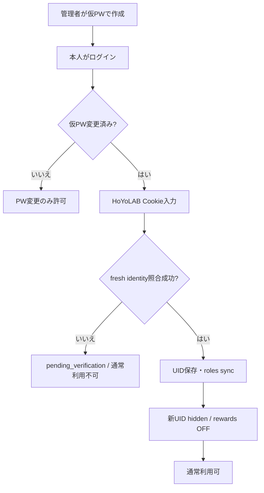

# AttOsHoYoDashboard 仕様書

## 1. 目的と現在の公開状態

AttOsHoYoDashboard は、小規模な身内用に HoYoLAB のゲーム状態確認とログインボーナス管理を行う Web Dashboard である。対象は海外版 HoYoLAB の原神と崩壊：スターレイル、利用者はスマートフォン・デスクトップのブラウザである。

現在のUIは Dioxus 0.7.10 Web/WASM RSX で作成する。UIはstandalone workspace crate `dashboard-ui` / package `attos-dashboard-ui` で、公式Dioxus Components由来のButton/Card/Card partsをsource templateとして使う。公開routeは `/`, `/docs`, `/openapi.json` で、`/` と `/docs` は同じcompiled Dioxus `index.html` を返す。`/docs` はread-only OpenAPI viewerで、認証やtry-it mutationは提供しない。Dioxus buildのhash付き `/assets/{...}` は内部assetであり、`/assets/app.js`・`/assets/style.css`・`/assets/docs.js` のような安定API routeは仕様に含めない。

HoYoLAB連携・手動報酬受け取り・自動報酬受け取りは通常機能として利用できる。Cookie暗号化の設定と既存のidentity照合・roles sync、パスワード変更を完了することが必要で、自動受け取りは既定OFFをユーザーがONにする。利用可能であることは、実上流token-to-UID bindingや報酬期間・POST反映契約の実証完了を意味しない。実GET疎通の成功、単一実アカウントやmockの結果だけでそれらを証明したとは扱わない。

## 2. 利用者、認証、セッション

| 利用者 | できること |
|---|---|
| 管理者 | ユーザー作成、無効化・再有効化、管理者権限の付与・解除（自身の権限は変更不可）、仮パスワード復旧、本人または他ユーザーの削除要求、ユーザー一覧（HoYoLAB連携状態・自動受け取りONのゲーム数・最終ログイン、連携の健全性：ゲーム状態の最終取得成功日時、ゲームごとの自動受け取りと直近の実行結果・日時・エラー種別、「要対応」の絞り込み）と監査ログの閲覧 |
| 一般ユーザー | 自身のパスワード変更、任意passkey、HoYoLAB Cookie登録、自身のゲーム状態・報酬設定、自己削除 |

- 招待・自由登録・OAuth・外部クライアント専用のAPIは提供しない。外部ツールは、本人が設定画面で発行するAPIトークン（scope `read`/`run`）で既存の読み取りと手動受け取りのendpointを呼べる。
- ブラウザの認証はWebセッションCookie。HTTPSでは `__Host-attos_session`、localhost HTTPでは `attos_session` を使う。Cookieは HttpOnly / SameSite=Strict、HTTPSでは Secure。
- セッションはログイン時から固定期限（既定7日）で、アクセスでは延長しない。本人はセキュリティ画面で有効なセッション（ログイン日時・最終利用（5分単位で記録）・ブラウザ）を一覧でき、他のセッションを個別または一括でログアウトできる。現在のセッションはログアウト操作で終了する。期限切れセッションは1時間ごとに削除する。ログイン成功時に最終ログイン日時とauditを記録し、パスキーは最終利用日時と名前の変更に対応する。パスワード変更は他セッションを失効させ、現在セッションの期限は延長しない。
- 初回・再発行後の必須パスワード設定は新パスワード＋確認のみを入力し、ログイン時の仮パスワードを保持しない。`PUT /api/v1/me/password` の `current_password` は、ユーザー行lock下で再認証した最新アカウントが `must_change_password=true` の場合のみ省略（またはnull）できる。通常変更は正しい現在パスワードが必須で、明示した不正な値は必須設定時も拒否する。新パスワードは省略時も保存済みパスワードと異なる必要があり、確認入力はクライアントで照合してAPIには送らない。失効・期限切れセッションや競合でhash/必須flagが変わったsnapshotは拒否する。
- Cookieで認証するmutationは同一Originを必須とし、`Origin` が `PUBLIC_ORIGIN` と完全一致しなければ拒否する。Cookieを伴わないBearer APIトークンの要求はOrigin確認の対象外とする。
- JSON DTOは未知fieldを拒否する。エラーは安全な `error` code とsanitized `message` で返し、Cookie・パスワード・セッショントークン・上流raw messageを含めない。
- ログイン入口（パスワードログイン、passkey options/verify）は、入力されたユーザー名ごとに60秒あたり20回に制限し、超過時は429を返す。reverse proxy経由のためIPは使わない。ユーザー名指定のpasskey verifyはchallengeを発行したユーザー名の枠を使い、存在しないchallengeは枠を消費しない。ユーザー名なしのdiscoverable optionsは枠を消費せず（pending上限で503）、verifyはuserHandleから特定したユーザーの枠を署名検証前に消費する。ユーザー名として無効な入力は1つの枠を共有し、枠の表は上限1024件で期限切れ・最古の順に捨てる。全体のCPUはArgon2とpasskeyのworker上限（各4）で抑え、worker枠が満杯の場合は待機列を増やさず503を返す。
- Androidアプリはパスキーをブラウザ経由で使う。アプリがPKCE（S256）のchallengeを付けて `/app-login` をブラウザで開き、ブラウザのセッション（パスワードまたはパスキーでログイン）で本人が明示的に許可すると、`POST /me/app-login` が120秒・1回限りのコードを返す。コードは `cc.attodao.ahd://login` でアプリに渡り、アプリは `POST /auth/app-login/exchange` でコードとverifierを新しいセッションに交換する。交換は許可したブラウザのセッションがまだ有効なことを確かめ、成功時は通常のログインと同じく最終ログイン日時とauditを記録する。APIトークンでは許可できない。
- AndroidアプリはセッションCookieを、ユーザー認証を要求しないAndroid Keystoreの取り出せないAES-256-GCM鍵で暗号化して保存し、バックアップと端末間の移行から除外する。復号できない保存（鍵がない・別の鍵・破損）はログアウトとして扱い、Keystoreの一時的な失敗はログアウトとして扱わない（同じプロセスで5分以上・5回以上続けて失敗した場合を除く）。1.9.0までの平文の保存は最初の読み込みで暗号化して削除する。
- Androidアプリの接続先はビルド時の `AHD_SERVER_URL` を既定とし、ログイン画面で別のAHDサーバーのOriginに変えられる。HTTPSだけ（開発用に `http://localhost`・`http://127.0.0.1` だけ例外）で、Originだけを保存し、`GET /health` がAHDの健康状態を返すサーバーだけを受け付ける。変えると古いサーバーのセッションCookie・UnifiedPushと受信箱の登録・通知・ウィジェット・通知の予定・画面のデータを端末から消し、古いサーバーのデータを新しいサーバーの選択中に表示しない。アプリの更新確認は接続先と無関係にビルド時の `AHD_UPDATE_*` のForgejoリリースを使う。
- `POST /auth/passkey/options` は `username` 省略時（`{}`）にアカウント情報を含まないdiscoverable optionsを返す。新規登録はresident keyをpreferredで要求する。`username` 指定時はアカウントの有無・passkeyの有無・無効化／仮パスワード状態を区別しない。利用可能なpasskeyがないユーザー名にも200で同じ形のoptions（保存済みだが完了できないchallengeと、ユーザー名からHMACで決めた1件のcredential ID）を返し、verifyは誤ったassertionと同じ401とする。HMAC鍵は `HOYOLAB_COOKIE_KEY` から用途別に導出し（未設定時はプロセスごとの乱数）、同じ名前への再問い合わせでは同じIDになる。複数passkeyを持つユーザーのID件数と、実在IDの長さ・transportsは区別し得る残差として許容する。ユーザー名として無効な入力は従来どおり401。
- ログイン中の現在パスワード確認（パスワード変更、本人・管理者による削除要求）は、操作者のユーザーIDごとに60秒あたり20回に制限し、超過時は429を返す。ログインの枠とは別に数えるため、奪われたセッションからの総当たりが本人のログインを止めることはない。

## 3. 初期設定と通常利用ゲート

初回または復旧後のユーザーは、仮パスワード変更と upstream identity照合済み HoYoLAB Cookie の両方を終えるまで通常のゲーム・報酬APIを利用できない。限定的に利用できるのは `/me`、パスワード変更、Cookie入力、任意passkey/セキュリティ、管理者のbootstrap/account management、およびPW変更後の本人削除である。管理者復旧は信頼境界だが、通常画面/APIから他人のゲームデータを直接閲覧する経路は作らない。管理者のユーザー一覧の連携の健全性は保存済みの状態・日時・sanitized error codeだけで、Cookie・HoYoLAB／ゲームUID・ゲームデータ・上流raw errorを含めず、表示のためにHoYoLABへ要求しない。APIトークンでは読めない（セッション専用）。「要対応」は、Cookieが失効・拒否された（`cookie_invalid`）、または本人確認済み（`verified`）の連携でゲームの報酬設定がHoYoLAB側の確認待ち（`action_required`）、またはゲームの直近に終わった実行が失敗・要対応・結果不明のいずれかのユーザーとする。未連携・本人確認待ち・Cookie削除済みは、残っている履歴があっても含めない。実行履歴は`REWARD_HISTORY_DAYS`で削除されるため、古い失敗はその期間で一覧から消える。

## 4. HoYoLAB連携とUID

- 1 Dashboardユーザーにつき HoYoLABアカウントは1個。追加連携、別UIDへの置換は提供しない。
- 本人は保存済みCookieを削除できる（`DELETE /api/v1/me/hoyolab/cookie`）。本人確認済みの連携は `removed` となり、暗号文を消してUIDの紐付け・ゲーム表示・履歴・送信ガードを残し、全ゲームの自動受け取りをOFF（次回予定も消去）にする。通常利用の条件を満たさなくなるため初期設定ゲートに戻り、同じHoYoLAB UIDのCookie登録と本人確認でのみ復帰できる。未確認の連携は行ごと削除する。削除済みの連携でユーザー削除を完了する場合、不確定な送信はGET確認できないためunknownのまま記録する。
- verified HoYoLAB UID は全ユーザーで一意。同一UIDのCookie更新だけが設定・履歴・game visibilityを維持して許可される。
- Cookie claimやrolesのgame UIDだけを本人HoYoLAB UIDの証明にしない。候補の `account_identity()` と `community_identity()` は実装済みだが、token-to-UID binding とroles principal一致の本番証拠ではない。
- Cookie parserはlegacy/v2の正規化保存に対応する。ブラウザからコピーした `Cookie: ...` ヘッダー行を受け付け、空・値なし・不正な名前の要素は無視する。新規登録では有効な `ltoken_v2`・`ltuid_v2`・`ltmid_v2` が各1つ必須で、それ以外（旧形式Cookieや他のUID/MID alias、その重複・不一致）は無視する。MIDの必須性は未実証のため、MIDなしの登録は受け付けない。保存済みCookieの復号時は、MIDなし・旧形式も従来どおり読み込む。draft verification pathは現在 v2 ltoken credential だけを受け入れる。MIDが本当に不要かは未実証で、`ltuid`+`ltoken`だけで十分とは書かない。
- Cookie平文はAPIで返さず、ownerと検証済みUID contextに束縛してAES-256-GCMで保存する。key/AAD mismatchや改竄はfail closed。ブラウザUIもlocalStorageに秘密を保存せず、same-origin credentialsでAPIを呼ぶ。
- roles syncで見つかった新ゲームUIDはhidden by default。未検出UIDは管理用に保持し、取得・表示しない。再検出時は以前のvisibilityを復元する。

## 5. Dashboardユーザー削除

削除はDashboardユーザー削除であり、HoYoLAB unlink APIではない。本人削除と管理者による他ユーザー削除を許可し、どちらも actor の現在パスワードと、対象usernameの完全一致入力を要求する。

| 条件 | 挙動 |
|---|---|
| 最後のactive admin削除 | 拒否 |
| inactive adminを別active adminが削除 | 許可 |
| 削除要求受付 | 202。対象を即時inactive化し、全セッション・passkeyを失効し、deletion requestを永続化 |
| 背景完了 | owner operation lockを待ち、既送信POSTの必要なGET-only確認を有界に行い、対象の全データを削除 |
| 監査 | targetのaudit/dataは削除。対象がactorとして残る他者auditは actor=null にできる |
| UID | 削除完了でverified UID uniquenessを解放 |

削除待ち中は新規実行・再試行・未送信POSTを禁止する。別ユーザーのowner operationはglobal serializationしない。

## 6. ゲーム状態

ゲーム状態APIは所有者の verified link と password changed を要求する。状態cacheはゲームUIDごとの最新curated JSON version 3で、TTLは5分。hidden/undetected UIDはnote fetchしない。fetch失敗時は既存payload/fetched_atを保持し、sanitized error_code/error_atを別に記録する。future fetched_atはfresh扱いしない。

初期表示対象:

| 原神 | 崩壊：スターレイル |
|---|---|
| `current_resin`, `max_resin`, `resin_full_at` | `current_stamina`, `max_stamina`, `stamina_full_at` |
| `current_home_coin`, `max_home_coin`, `home_coin_full_at` | `current_reserve_stamina` |
| `finished_task_num`, `total_task_num`, `is_extra_task_reward_received` | `current_train_score`, `max_train_score` |
| `remain_resin_discount_num`, `resin_discount_num_limit`（週ボス割引の残り） | `weekly_cocoon_cnt`, `weekly_cocoon_limit`（歴戦余韻の残り）, `current_rogue_score`, `max_rogue_score` |
| `transformer_obtained`, `transformer_ready`, `transformer_ready_at`（参量物質変化器） | `is_reserve_stamina_full`, `rogue_tourn_weekly_*`（差分宇宙、解放時のみ） |
| `current_expedition_num`, `max_expedition_num` | `accepted_expedition_num`（上流の綴り誤り `accepted_epedition_num` を改名）, `total_expedition_num` |
| expeditions: `status`, `name`, `remained_time`, `avatar_side_icon` | expeditions/assignments: `status`, `name`, `remaining_time`, `item_url` |

原神の派遣表示はavatar iconを使い、名称は代替テキストに残す。スターレイルの派遣欄は表示しない（APIの取得fieldは維持する）。画像は公式画像CDNのみ許可し、Refererを送らない。欠落・読込失敗時は代替アイコンとラベルを保つ。旧cache versionは新しい派遣fieldを持たないため再取得する。上流が空配列を返した場合と派遣field自体がない場合を区別する。

不足fieldから非公開・非対応などを断定しない。推定増加・未確認上限（予備開拓力の上限値など）は対象外。主リソースは上限の90%以上で「まもなく上限」、上限で「上限」を表示する。

### 6.1 高難度コンテンツ

`GET /api/v1/game-accounts/{id}/challenges` は、ゲーム状態と同じ条件（verified link、password changed、所有するvisible/detectedのUIDだけ、sanitized error code、所有者単位の操作ロック、保存前のlink・credential version再確認）で、現在の期間の要約を返す。

| 原神 | 崩壊：スターレイル |
|---|---|
| 深境螺旋 `GET /spiralAbyss?schedule_type=1` | 混沌の記憶 `GET /challenge?schedule_type=1&need_all=true` |
| 幻想シアター `GET /role_combat?need_detail=false` | 虚構叙事 `GET /challenge_story?schedule_type=1&need_all=true` |
| 幽境の激戦 `GET /hard_challenge?need_detail=false` | 末日の幻影 `GET /challenge_boss?schedule_type=1&need_all=true` |
| | 異相の仲裁 `GET /challenge_peak?schedule_type=1` |

- 要約はモードごとに `unlocked`、`has_data`、期間名、`starts_at`／`ends_at`、星（幻想シアターは勲章）、到達階層、幕、難易度、最速クリア秒数、戦闘回数だけ。編成・キャラクター順位・ダメージなどのキャラクター別戦績は読まず保存しない（§9）。
- フィールド名はgenshin.py由来で実応答では未検証。上流JSONは型付けせずに防御的に読み、欠けた値・型の違う値は `null`（不明）にする。欠落から未開放・非公開・非対応を推定しない。
- Unix秒の時刻はそのまま、年月日時分の時刻はアカウントのサーバー時刻（アメリカUTC-5、ヨーロッパUTC+1、アジア・台港澳UTC+8）として解釈する。未知のサーバーでは推定せず `null`。
- cacheはゲームUIDごとの `game_challenge_cache`（payload version 1、UID削除・ユーザー削除でcascade）。TTLは `CHALLENGE_CACHE_TTL_MINUTES`（既定60分、5〜1440）。日々変わる状態より取得間隔を長くし、期間の終了が取得後に来た場合はTTL内でも取り直す。
- モードは順に取得する。Cookie無効の応答で残りを中止しlinkを `cookie_invalid` にする。すべて失敗したときは既存payload/fetched_atを保持してerror_code/error_atを記録する（`upstream:10102` は状態と同じく `STATUS_CACHE_TTL_MINUTES` の間再取得しない）。一部だけ失敗したときは成功分を保存し、失敗したモードに `error_code` を付け、`STATUS_CACHE_TTL_MINUTES` 後に取り直す。
- 報酬設定が `action_required` のゲームは取得せず、既存の要約を `action_required` 付きで返す。
- APIトークンは `read`・`run` の両スコープで読める（状態と同じ読み取り専用のダッシュボードデータのため）。
- 「期間の終了が近く未クリア」の通知は対象外（未実装）。

### 6.2 イベントカレンダー

`GET /api/v1/game-accounts/{id}/calendar` は、ゲーム状態と同じ条件（verified link、password changed、所有するvisible/detectedのUIDだけ、sanitized error code、所有者単位の操作ロック、保存前のlink・credential version再確認）で、開催中・開催予定のイベントと祈願／跳躍を返す。

| 原神 | 崩壊：スターレイル |
|---|---|
| `POST /act_calendar`（本文は共通の`role_id`・`server`だけ） | `GET /get_act_calender`（`calender`は上流の綴り） |
| キャラクター・武器・集録の祈願（`avatar_card_pool_list`・`weapon_card_pool_list`・`mixed_card_pool_list`）、イベント（`act_list`） | キャラクター・光円錐の跳躍（`avatar_card_pool_list`・`equip_card_pool_list`）、イベント（`act_list`） |

- `POST /act_calendar` は状態を変えない照会である。`docs/hoyolab-game-record/genshin.md` の一覧で書き込みとされるのは `/character/top` だけで、genshin.pyでもカレンダーの取得関数（`get_genshin_event_calendar`）が共通の`role_id`・`server`だけをPOSTする。それ以外の本文は送らない。
- `GET /activities`（原神のイベント記録）は使わない。イベントごとにキーと形が違い、カレンダーのイベントと対応付けられない。参加状況はカレンダーの完了（原神`is_finished`、スターレイル`all_finished`）・未開放（スターレイル`act_status`の`…Unopened`）・進捗（スターレイル`current_progress`／`total_progress`、原神の報酬倍増の使用回数）で示す。
- 項目はkind・ID・名前・バージョン・開始／終了・完了・未開放・進捗・ピックアップ（名前・レアリティ・画像）だけ。説明文・報酬一覧・攻略リンクは読まず保存しない。フィールド名はgenshin.py由来で実応答では未検証。欠けた値・型の違う値は `null`（不明）にし、未開放や未参加を推定しない。
- 取得時点で終了済みの項目、高難度コンテンツ（`fixed_act_list`・`challenge_list`、§6.1と重複）、常設のモード（`ActTimeTypeLong`）は返さない。開始が取得時刻より後の項目は開催予定として返す（上流が返すときだけ）。
- 画像は公式画像CDN（CSPの`img-src`と同じhost）のhttps URLだけを残し、UIはRefererなしで読み込む。欠落・読込失敗時も名前の文字は残す。
- cacheはゲームUIDごとの `game_calendar_cache`（payload version 1、UID削除・ユーザー削除でcascade）。TTLは `CALENDAR_CACHE_TTL_MINUTES`（既定60分、5〜1440）。取得後に開始・終了した項目があればTTL内でも取り直す。失敗時は既存payload/fetched_atを保持し、`STATUS_CACHE_TTL_MINUTES` の間は再取得しない（毎分の読み直しで上流へ問い合わせ続けないため）。
- 報酬設定が `action_required` のゲームは取得せず、既存のカレンダーを `action_required` 付きで返す。
- APIトークンは `read`・`run` の両スコープで読める（状態と同じ読み取り専用のダッシュボードデータで、上流でも状態を変えないため）。
- UIはダッシュボードではなく「イベント」画面（`/events`）に置く。イベントと祈願／跳躍はUIDに結び付かない（同じゲームなら全UIDで同じ）ため、ダッシュボードはUIDに結び付く情報だけにする。web版はメニューの先頭、アプリは下部バーのダッシュボードの次から開く。カレンダーは各ゲームの表示UID（ダッシュボードと共通の選択、未選択なら最初の表示UID）を通してこの画面を開いたときに読み、ダッシュボードでは読まない。ゲームごとに1行の要約（開催中の件数・開催予定の件数・期間不明の件数・次の終了までの残り）とタイムラインを出す：601px以上のweb版は横向き（月・日の軸、今日の印、祈願／跳躍とイベントの行ごとに開始から終了までのバーと名前・期間・残り時間・ピックアップ・進捗）、600px以下とアプリは縦向き（「現在」から開催中を終了の早い順、開催予定を開始日ごと）。開始も終了も不明な項目は、どちらの向きでもバーを描かず最後の「期間不明」グループに出す。残り時間とグループ分けは共通の`Clock`で毎秒計算する。読み込み中・取得失敗（表示中の内容は残す）・空・表示するUIDなしの状態を区別する。
- アカウントに依存しないカレンダーのAPI（UIDなしで読めるエンドポイント）は追加しない。上流の `act_calendar`／カレンダーAPIがUID（`role_id`／`server`）を要求し、イベントの進捗はUIDごとに違うため、既存の `GET /game-accounts/{id}/calendar` とUIDごとのcacheをそのまま使う。
- 「終了間近の未完了イベント」の通知は対象外（未実装）。

### 6.3 樹脂・開拓力の履歴と上限に達していた時間

`GET /api/v1/game-accounts/{id}/resource-history` は、主リソース（原神は天然樹脂、スターレイルは開拓力）が直近7日間に上限に達していた時間を返す。認可は一覧と同じ（verified link、password changed、所有するUIDだけ、所有者単位の操作ロック）で、HoYoLABへは問い合わせない。

- 記録：`/status` の取得（ダッシュボードの読み直しと通知ワーカーの15分ごとの確認）が成功し、要約に件数と上限があるたびに、`resource_history` へ1行（UID・取得時刻・件数・上限・全回復時刻）を追加する。キャッシュから返した応答と失敗した取得は記録しない。履歴のための上流要求はない。
- 保持：`RESOURCE_HISTORY_DAYS`（既定7、7〜90。集計する7日間より短くはできない）に90分（窓の直前の起点の行を残すため）を足したより古い行を、1時間ごとの保守で削除する。UIDを非表示にした時点でそのUIDの行を削除し、保守でも非表示・未検出のUIDの行を消す（取得と非表示の競合を含む）。UID・HoYoLAB連携・ユーザーの削除ではforeign keyのcascadeで消える。
- 計算（純粋関数 `games/cap_time.rs`）：スナップショットの間は回復速度（樹脂8分・開拓力6分で1）で何もしなかったと仮定して件数を進める。全回復時刻は件数からの見込みと1回復分以内で一致するときだけ使う。
  - 次のスナップショットが90分以内で、見込みと1以内で一致したときだけ、見込みの上限到達から次までを「上限」と数える。
  - 見込みの上限到達より前は「回復中」（消費しても上限到達は遅れるだけのため、間隔が長くても確定）。
  - 上限到達より後で、間隔が90分を超えるか見込みより少なかった（消費した）ときは「不明」。推測しない。
  - 見込みより多かった（アイテムでの回復）か上限が変わったときは、その区間全体を「不明」にする。
  - 最後のスナップショットの後は90分までだけ見込みで進め（その間の上限到達以降は「上限」）、90分より後と、90分より後に見込みの上限に達する場合のそれ以降は「不明」。窓の始まりから最初のスナップショットまでも「不明」（窓の直前90分以内の行があればそれを起点にする）。
- 応答：`resource`（`resin`／`trailblaze_power`）、`unit_seconds`、`max_gap_seconds`、`window_start`・`window_end`、窓内の `sample_count`、`at_cap_seconds`・`unknown_seconds`、窓全体を隙間なく覆う `segments`（`at_cap`／`below_cap`／`unknown`、開始・終了・秒数）。非表示・未検出のUIDは行を持たないため窓全体が「不明」。
- APIトークンは `read`・`run` の両スコープで読める（保存済みの行だけを読むダッシュボードデータのため）。
- `/metrics` には出さない（ユーザー・UIDごとの値になり、運用の判断に使わないため）。
- UIは各ゲームカードの主リソース（アイコン・数値・バー・全回復までの残り時間）の直下に、履歴のアイコンと「7日間の上限」、その合計、7日間のタイムライン（上限＝warning色の太いブロック、回復中＝ゲームの色の細い線、不明＝斜線。軸ラベルと凡例は置かない）、不明の時間があるときだけ「不明 15時間」を置く。タイムラインは装飾として読み上げから外し、同じ内訳を視覚的に隠した文で読み上げる。記録がなければ「まだ記録がありません。」、更新の失敗は直前の履歴を残して注記する。

## 7. ログインボーナス

- 設定単位は HoYoLABアカウント × game。既定OFF、既定local time `06:00`、server共通固定offset（既定 `+09:00`）。ユーザー別TZ/DSTはない。
- ON、時刻変更、Cookie更新の後は厳密に次の未来tickまで待つ。手動runはenabled flagと独立だが、同じverified link・認可・credential version検査を要求する。
- schedulerはpage viewに依存しない。停止中に時刻を逃した場合は現在分だけcatchupし、過去分を補填しない。
- 実行はPOST前にdaily statusをGET確認する。成功はPOST応答だけでなく最終状態で確認する。
- pre-POST/GET retry pathは初回+最大3回、10秒backoffを永続化する。不明または送信可能性がある場合はdurable guardを立て、restart・credential update・5日履歴cleanup後も無条件POST再送しない。
- 定時の時刻から5分以内に開始したrunは `scheduled`、それより遅れた（停止中・延期）runは `catchup` と記録する。履歴の掃除は1時間ごと。
- 報酬状態の取得時に、その月の報酬一覧（`home`）を報酬月（UTC+8）ごとに1回だけGETしてキャッシュし、`total_sign_day` と当日の報酬（未受け取りなら次、受け取り済みならその日の分）を返す。一覧の取得失敗は状態取得を失敗させない。
- 画面の手動受け取りはダッシュボードの1つの操作にまとめ、本日分が未受け取りで実行可能なゲームだけに報酬設定ごとのPOSTを1回ずつ送る。
- 手動runとschedulerは同じworkerを使用する。追加認証要求はaction_required、不確定な送信結果はunknownとして停止し、無条件にPOSTを再送しない。

## 7.1. 設定の移行（書き出し・読み込み）

- 利用者は自分の設定をJSONファイル（`"format": "ahd-settings"`, `"version": 1`）として書き出し、別のinstanceや作り直したinstanceで読み込める。web版の設定タブ「設定の移行」だけで扱い、アプリには出さない（WebViewにファイル選択とダウンロードの処理がないため）。
- 含めるもの: ログインボーナスの自動受け取り（gameごとのON/OFF・時刻）、ゲームUIDごとの表示、通知（Webhookとアプリ受信箱の種類ごとの選択、形式、言語、樹脂の警告時間、デイリー・週間のリマインダー時刻）、Webhookが設定済みかどうかのflag。言語・テーマはブラウザに保存する設定でサーバーにないため含めない。
- 含めないもの: HoYoLAB Cookie、Webhook URL、パスワード、パスキー、セッション、APIトークン。読み込みはWebhook URLを変更しない。書き出し元にWebhookがあり読み込み先にない場合は、設定し直すよう案内する。
- 読み込みは厳密に検証する。未知の項目・型違い・範囲外・重複・件数超過（報酬2件、UID 64件）・未対応の形式や版は、項目のパス（例 `rewards[0].local_time`）と種類（`missing`・`type`・`unknown`・`invalid`・`unsupported`・`duplicate`・`too_many`）の一覧（最大50件）で示し、何も反映しない。ファイルの上限はAPIのbody上限と同じ16KiB。
- 反映の前にプレビュー（`POST /me/settings/import/preview`）で変わる設定・反映しない項目を示す。反映（`POST /me/settings/import`）は同じ計画を1トランザクションで書き、結果の一覧を返す。通知の種類のうちファイルにないものは現在の選択を保つ。
- 報酬とUIDの表示は検証済みのHoYoLAB連携に属する。連携がない（`not_linked`）、そのgameの報酬がない（`game_not_found`）、そのUIDがない（`uid_not_found`、UIDは作らない）、HoYoLABでの対応が必要な報酬をONにする（`reward_not_ready`）項目は飛ばして理由を示す。時刻・ON/OFFの変更は設定画面と同じく保留中の定時runを止め、次の未来tickを待つ。
- セッション専用で、APIトークンでは使えない（403）。変更要求には他の操作と同じく `Origin` が必要。

## 8. Web API契約

OpenAPI 3.1 の正本は [`../dashboard-api.json`](../dashboard-api.json)。現在のAPIはWeb UI用であり、PATや外部クライアント認証ではない。実装済みrouteだけを載せ、HoYoLAB上流の `/record` や `/daily` などの架空proxy routeは作らない。

主なroute群:

- public: `/health`, `/`, `/docs`, `/openapi.json`（hash付き `/assets/{...}` はDioxus内部assetで、OpenAPI pathではない）
- auth: login/logout、passkey login start/finish、app-login exchange
- me: `/api/v1/me`, password, passkeys, app-login approval, deletion
- admin: user list/create/active/reset/delete
- HoYoLAB: status/cookie/verify/sync
- games: game accounts list/visibility/status/challenges/calendar/resource-history
- rewards: settings/update/manual run/history
- settings transfer: `GET /me/settings/export`、`POST /me/settings/import/preview`・`/me/settings/import`（セッション専用。`ahd-settings` 版1）

## 9. 対象外

招待・自由登録、PAT/Scope、メール復旧、Cookie自動更新、複数HoYoLAB連携、別UID置換、CAPTCHA自動突破、他人へのゲームデータ共有、中国本土版、原神・崩壊：スターレイル以外、網羅的キャラクター戦績、email通知、FCMによるプッシュ（Androidアプリのサーバー通知は受信箱のポーリングと、任意のUnifiedPushによる起床だけ）、native mobile app、SSR/fullstack新server、DST対応。
